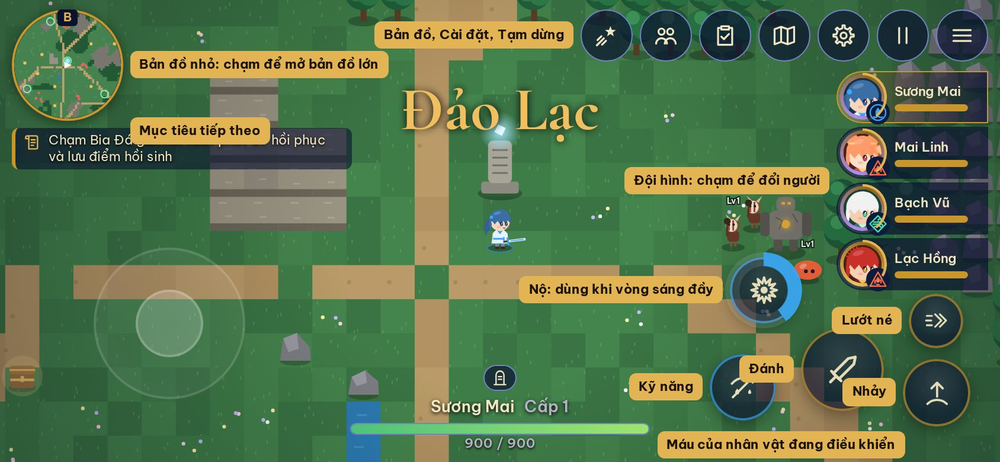
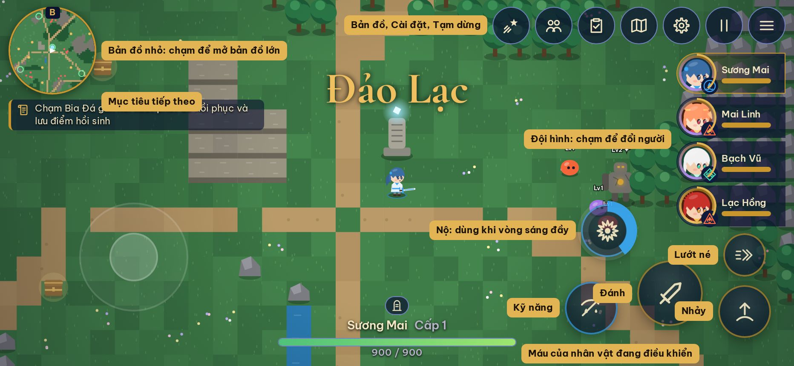
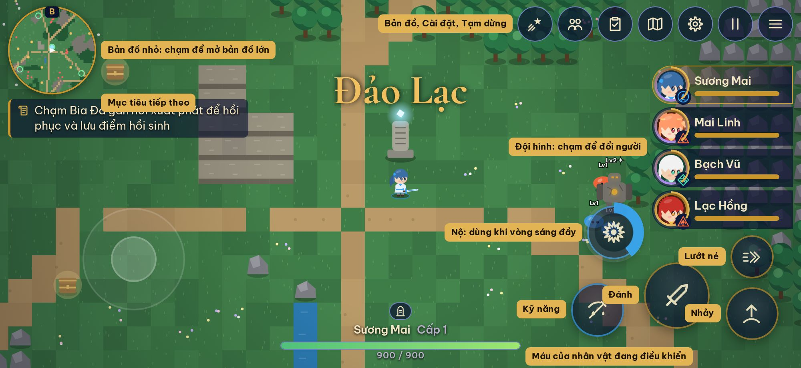
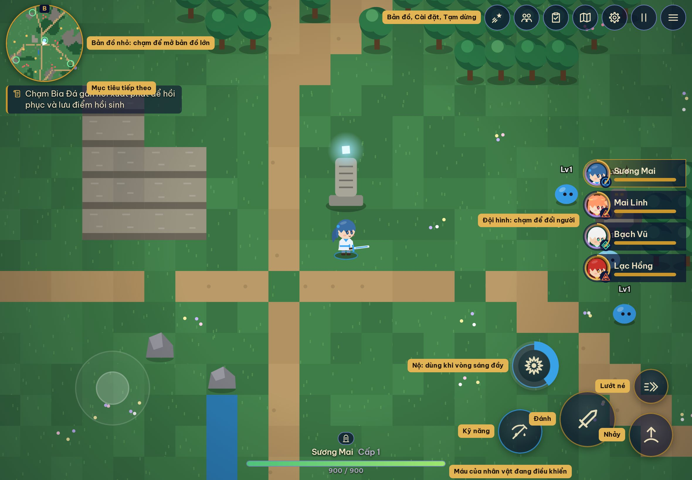
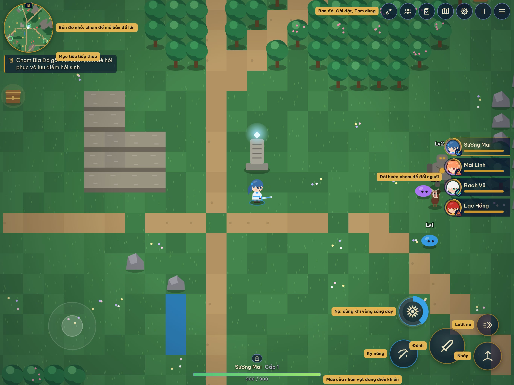
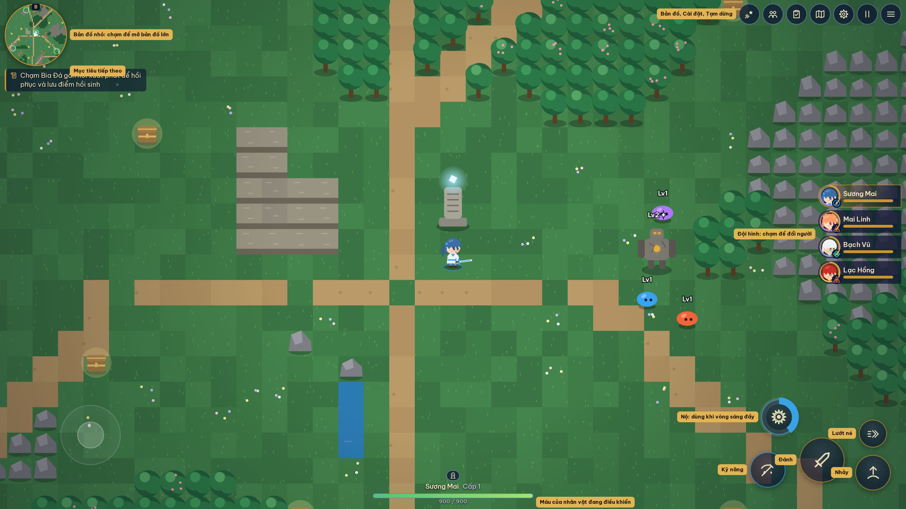
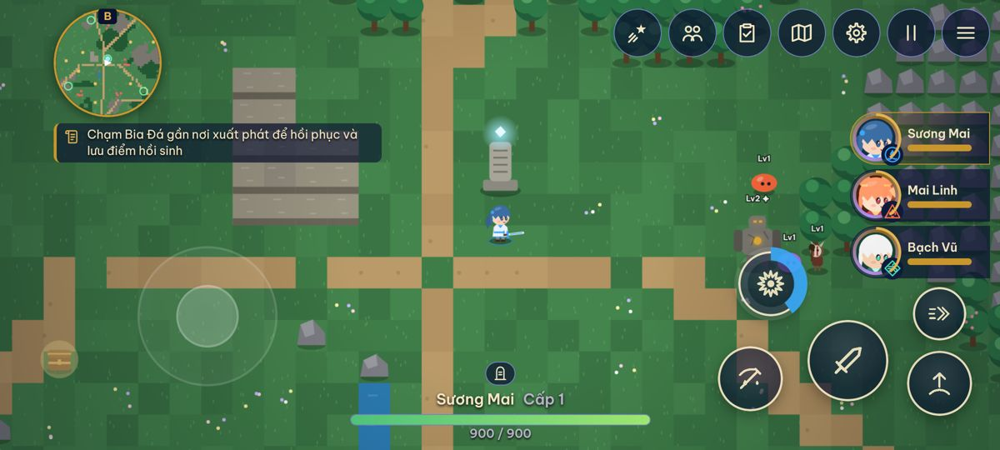
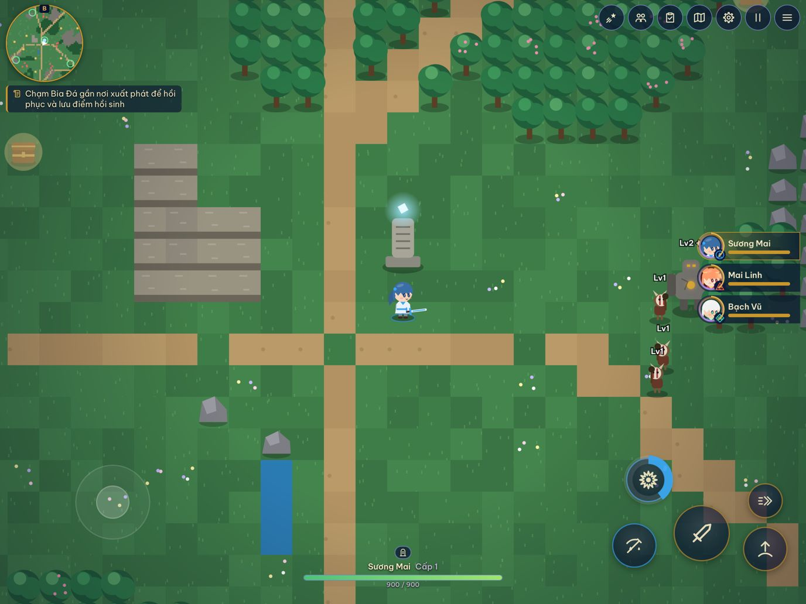
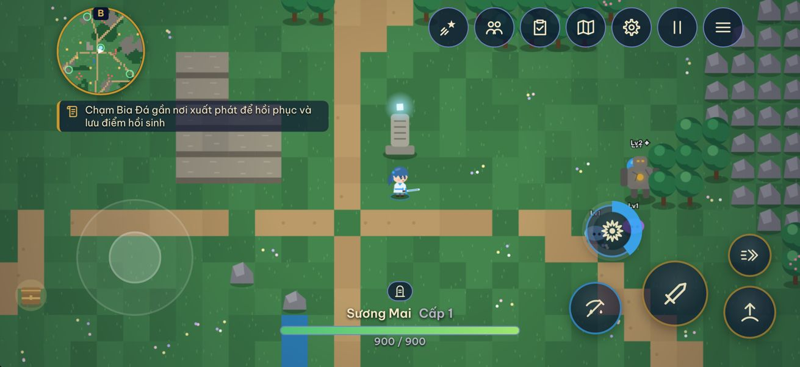

# Cài Tinh Tú Ước Nguyện

Tinh Tú có bản web (chơi ngay trên trình duyệt) và bản cài đặt cho từng loại máy. Bản cài đặt chạy toàn màn hình, không còn thanh địa chỉ hay thanh tab, chơi được cả khi mất mạng. Mọi bản đều miễn phí.

Tải file cài đặt ở trang **[Releases mới nhất](https://github.com/Dungeon067/DUngeon/releases/latest)** (trong game: Cài đặt → Ứng dụng → **Tải bản cài đặt**). Các bản thử (tên có `-test`) nằm ở [danh sách Releases](https://github.com/Dungeon067/DUngeon/releases), đánh dấu _Pre-release_.

| Máy                 | Cách cài                              | File                                         |
| ------------------- | ------------------------------------- | -------------------------------------------- |
| iPad, iPhone        | Thêm bản web vào màn hình chính (PWA) | không cần file                               |
| Android             | Cài file APK                          | `TinhTu_…_android.apk`                       |
| Windows 10/11       | Chạy file cài đặt                     | `TinhTu_…_windows_x64-setup.exe` hoặc `.msi` |
| macOS 10.15 trở lên | Mở file DMG, kéo vào Applications     | `TinhTu_…_macos_universal.dmg`               |
| Linux (x86_64)      | Cho phép chạy file AppImage           | `TinhTu_…_linux_x86_64.AppImage`             |

Game chỉ chơi màn hình **ngang**. Cầm máy dọc thì game hiện màn "Xoay ngang để chơi".

## iPad và iPhone (PWA)

1. Mở bản web của game bằng **Safari** (Chrome trên iOS không có mục này).
2. Chạm nút **Chia sẻ** (ô vuông có mũi tên lên, ở thanh trên cùng trên iPad, thanh dưới cùng trên iPhone).
3. Kéo xuống, chọn **Thêm vào MH chính**, rồi chạm **Thêm**.
4. Mở Tinh Tú từ biểu tượng ngôi sao trên màn hình chính.

Lần đầu mở bằng Safari, game hiện một dòng gợi ý nhỏ ở trên cùng. Chạm ✕ để tắt, gợi ý sẽ không hiện lại.

Khi chạy từ màn hình chính, iPad vẫn giữ thanh trạng thái mờ (giờ, pin) ở trên cùng, vì iOS không cho bản web ẩn thanh này. Giao diện game đã chừa chỗ cho thanh trạng thái, tai thỏ và thanh home. Muốn ẩn hẳn thì dùng bản ứng dụng iOS, xem [ios.md](ios.md).

Khi có bản mới, game hiện nút **"Có bản cập nhật, chạm để tải lại"** ở dưới màn. Chạm vào để dùng bản mới (dữ liệu chơi vẫn giữ).

## Android (APK)

1. Trên máy Android, mở trang Releases, tải file `TinhTu_…_android.apk`.
2. Mở file vừa tải. Lần đầu, Android hỏi có cho phép cài ứng dụng từ trình duyệt không: chọn **Cài đặt** → bật **Cho phép từ nguồn này**, rồi quay lại.
3. Chạm **Cài đặt**. Nếu Play Protect cảnh báo "ứng dụng không xác định", chọn **Vẫn cài đặt**.

Bản Android tự khoá ngang, ẩn thanh hệ thống (vuốt từ mép màn để hiện tạm) và giữ màn hình sáng khi chơi. Bản mới cài đè lên bản cũ, không mất dữ liệu.

Cách khác: mở bản web bằng Chrome, vào Cài đặt → Ứng dụng → **Cài đặt** (hoặc menu ⋮ → **Cài đặt ứng dụng**). Cách này cài bản PWA giống trên iPad.

> **Khoá ký APK chỉ dùng cho bản thử.** APK được ký bằng một debug keystore cố định nằm ngay trong repo (`android/keystore/tinhtu-debug.jks`, mật khẩu ghi trong `android/app/build.gradle`). Ai cũng có thể ký một APK khác bằng khoá này, nên chỉ cài APK tải từ trang Releases của dự án. Trước khi đưa lên Google Play phải tạo keystore thật, lưu trong GitHub Secrets và đổi `signingConfigs` trong `android/app/build.gradle` sang đọc từ Secrets. Khi đổi khoá, người chơi phải gỡ bản thử rồi cài lại.

## Windows

1. Tải `TinhTu_…_windows_x64-setup.exe` (hoặc file `.msi` nếu máy cơ quan chỉ cho cài MSI).
2. Mở file. Windows SmartScreen có thể báo "Windows đã bảo vệ máy tính của bạn" vì bản cài chưa ký mã: chọn **Thông tin thêm** → **Vẫn chạy**.
3. Làm theo hướng dẫn cài, rồi mở **Tinh Tu Uoc Nguyen** từ menu Start.

Máy Windows 10 cũ chưa có WebView2 thì bộ cài tự tải về (cần mạng lần đầu).

## macOS

1. Tải `TinhTu_…_macos_universal.dmg` (chạy trên cả Mac chip Apple và Mac Intel).
2. Mở file DMG, kéo **Tinh Tu Uoc Nguyen** vào thư mục **Applications**.
3. Lần đầu mở: vào Applications, **chuột phải** (hoặc Control + bấm) vào ứng dụng → **Mở** → **Mở**. Bản này chưa ký bằng tài khoản Apple Developer nên macOS chặn nếu bấm đúp.
4. Nếu macOS 15 trở lên vẫn chặn: mở **Cài đặt hệ thống → Quyền riêng tư & Bảo mật**, kéo xuống, bấm **Vẫn mở**.

## Linux

1. Tải `TinhTu_…_linux_x86_64.AppImage`.
2. Cho phép chạy: chuột phải vào file → Thuộc tính → Quyền → bật **Cho phép chạy như chương trình**, hoặc chạy `chmod +x TinhTu_*.AppImage` trong Terminal.
3. Bấm đúp vào file để chơi.

Một số bản Ubuntu mới cần cài thêm `libfuse2` (`sudo apt install libfuse2`) để chạy AppImage.

## Bản máy tính: phím tắt

- **F11**: bật/tắt toàn màn hình (cũng có nút **Toàn màn hình** trong Cài đặt → Ứng dụng).
- Cửa sổ mặc định 1600×900, kéo giãn được.

## Ảnh giao diện

Danh sách đội ở cạnh phải giữa màn, cụm nút Đánh, Kỹ năng, Nộ, Lướt, Nhảy ở góc dưới phải, không chồng lên nhau ở mọi cỡ màn:

| Cỡ màn (CSS px)                        | Ảnh                                 |
| -------------------------------------- | ----------------------------------- |
| 844×390 (iPhone ngang)                 |      |
| 932×430 (iPhone Pro Max ngang)         |      |
| 1000×460 (iPad Safari còn thanh duyệt) |    |
| 1180×820 (iPad Air ngang)              |    |
| 1366×1024 (iPad Pro 12.9 ngang)        |  |
| 1920×1080 (máy tính)                   |  |

Bản ứng dụng chạy thử:

| Bản                                 | Ảnh                                               |
| ----------------------------------- | ------------------------------------------------- |
| Android (máy ảo Pixel 6, APK)       |               |
| iOS, iPad Pro 13 (Simulator, Xcode) |      |
| iOS, iPhone 17 (Simulator, Xcode)   |  |

## Cho người phát triển

- Bản web cài được (PWA): `vite-plugin-pwa` trong `vite.config.ts`, mã ở `src/ui/pwa.ts`. Service worker lưu sẵn mọi file build; âm thanh và video trong `media/` chỉ lưu khi được tải lần đầu. Trang `/admin/` và `/legacy/` không do service worker quản lý.
- Icon: vẽ ở `assets/icon/icon.svg`, xuất PNG bằng `pnpm icons` (cho web, Android, iOS). Icon bản máy tính: `pnpm tauri icon assets/icon/icon-1024.png`.
- Android: `pnpm android:apk` (cần JDK 21 và Android SDK), file ra ở `android/app/build/outputs/apk/release/`.
- Máy tính: `pnpm tauri build` (cần Rust; Linux cần thêm `libwebkit2gtk-4.1-dev`).
- Phát hành: đẩy tag `v*` (ví dụ `git tag v0.2.0 && git push origin v0.2.0`). Workflow `release-apps` build APK, `.exe`, `.msi`, `.dmg`, `.AppImage` và đính vào Release. Tag có dấu `-` (ví dụ `v0.2.0-test`) thành pre-release. Có thể chạy tay ở tab Actions; khi đó file nằm ở mục Artifacts.
