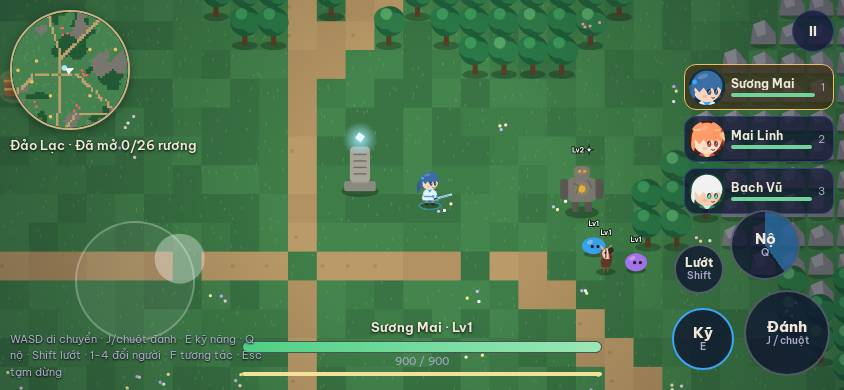
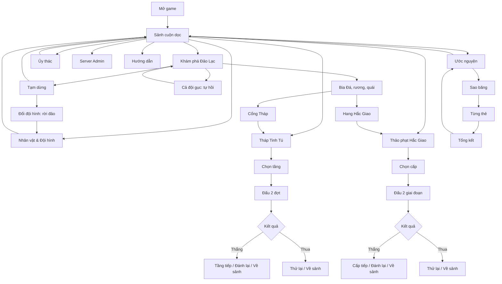
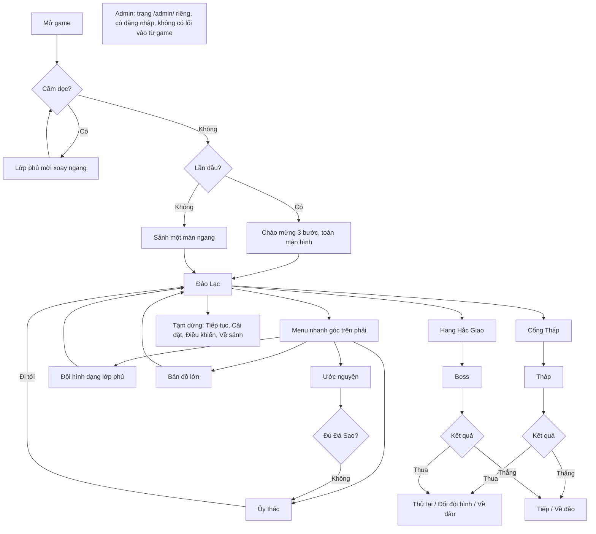

# Đánh giá UX bản hiện tại (S07)

Bản được đánh giá: bản Vite + TypeScript của S00 (nhánh `devin/1795346943-s00-vite-split`), chạy bằng `pnpm dev`. Không đánh giá `legacy/index.html`.

Tài liệu này chỉ ghi nhận hiện trạng và đề xuất. Không có dòng code game nào bị sửa trong session này.

## 1. Cách đánh giá

| Thiết bị                                         | Kích thước | Giả lập                               | Ảnh                      |
| ------------------------------------------------ | ---------- | ------------------------------------- | ------------------------ |
| Điện thoại ngang (ưu tiên số 1)                  | 844×390    | cảm ứng, `isMobile`, tỉ lệ điểm ảnh 3 | `anh/dt-*.jpg` (43 ảnh)  |
| Máy tính                                         | 1440×900   | chuột và bàn phím                     | `anh/pc-*.jpg` (42 ảnh)  |
| Máy tính bảng ngang                              | 1180×820   | cảm ứng, tỉ lệ điểm ảnh 2             | `anh/mtb-*.jpg` (43 ảnh) |
| Điện thoại dọc (chỉ kiểm tra lớp phủ xoay ngang) | 390×844    | cảm ứng                               | `anh/doc-*.jpg` (2 ảnh)  |

- Script chụp và đo: [`tools/chup-anh.ts`](tools/chup-anh.ts). Chạy lại: mở `pnpm dev`, rồi `pnpm exec tsx docs/ux/tools/chup-anh.ts` (lọc thiết bị bằng `CHI=dt,pc`).
- Số đo thô theo từng ảnh: [`tools/so-lieu.json`](tools/so-lieu.json). Gồm vùng chạm nhỏ hơn 44×44 px, tỉ lệ tương phản chữ DOM so với WCAG AA (4,5:1 cho chữ thường, 3:1 cho chữ lớn), chữ bị cắt (`scrollWidth > clientWidth`), phần tử tràn khỏi màn, chồng lấn giữa các phần tử HUD, chiều cao cuộn của từng màn.
- Script mở game bằng `?e2e` và gọi thẳng các hàm của game (ví dụ `partyWipe()`, `endRun()`, đặt máu boss) để tới đúng trạng thái thua, thắng, máu thấp. Các bước người chơi thường làm (bấm thẻ sảnh, bấm nút ước, bấm ô đội, kéo cần điều khiển) vẫn đi qua giao diện thật.
- Giới hạn: tương phản chỉ đo được với chữ DOM. Chữ vẽ trên Canvas (số sát thương, cấp quái, bản đồ nhỏ) được đánh giá bằng mắt trên ảnh. Giả lập Playwright không có tai thỏ, thanh địa chỉ trình duyệt hay lực ngón tay thật, nên phần "vướng ngón tay" dựa trên tọa độ đo được và kích thước ngón cái phổ biến (vùng với tới thoải mái khoảng 1/3 dưới mỗi bên màn ngang).

Mức nghiêm trọng:

- **Chặn chơi**: người chơi không chơi được hoặc vi phạm yêu cầu bắt buộc của A.3.
- **Cao**: phần lớn người mới gặp, gây bối rối hoặc thao tác sai thường xuyên.
- **Vừa**: gây khó chịu, có cách lách.
- **Thấp**: đánh bóng, nhất quán.

## 2. Tóm tắt

- Trên điện thoại ngang, HUD thiếu chỗ: cụm nút chiến đấu, danh sách đội và nút Nộ chồng lên nhau ở góc phải; gợi ý phím WASD vẫn hiện và đè lên thanh máu.
- Cầm dọc không có lớp phủ mời xoay ngang. Game vẫn chạy ở màn dọc. Đây là lỗi duy nhất ở mức Chặn chơi, vì A.3 bắt buộc.
- Các màn menu được thiết kế cho màn cao. Ở 390 px chiều cao, nút chính của Ước nguyện và Nâng cấp nằm dưới màn đầu, phải cuộn mới thấy.
- Người mới vào đảo không có mục tiêu, không có hướng dẫn điều khiển tại chỗ. Bản đồ nhỏ không chạm được.
- Tiếng Việt hiển thị đúng dấu ở mọi màn đã chụp. Hai phông Be Vietnam Pro và Cormorant Garamond đều tải xong (`document.fonts.check` trả về đúng ở cả 4 thiết bị).
- Máy tính và máy tính bảng ít lỗi hơn nhiều. Vấn đề chính là HUD có kích thước cố định theo px nên trông nhỏ và lạc lõng trên màn lớn.

## 3. Đánh giá riêng cho điện thoại ngang 844×390

### 3.1. Vị trí HUD đo được

| Phần tử                        | Vị trí (x, y, rộng × cao, px)       | Nhận xét                                                                                                          |
| ------------------------------ | ----------------------------------- | ----------------------------------------------------------------------------------------------------------------- |
| Bản đồ nhỏ `#mini`             | 10, 10, 120×120                     | Đúng góc. Chiếm 31% chiều cao màn. Breakpoint thu nhỏ còn 92 px chỉ áp dụng khi rộng ≤700 px nên không bật ở 844. |
| Dòng chế độ `#modeInfo`        | 10, 136, 187×20                     | Dưới bản đồ nhỏ, chữ nhỏ.                                                                                         |
| Nút tạm dừng                   | 792, 10, 42×42                      | Nhỏ hơn 44×44. Là nút duy nhất ở góc trên phải.                                                                   |
| Danh sách đội `.pm`            | 684, 64 / 116 / 168, mỗi thẻ 150×46 | Thẻ thứ 3 kết thúc ở y=214, nút Nộ bắt đầu ở y=210: chồng 70×4 px.                                                |
| Nộ `#bBurst`                   | 730, 210, 70×70                     | Sát thẻ đội.                                                                                                      |
| Lướt `#bDash`                  | 674, 244, 50×50                     | Nút nhỏ nhất nhưng dùng nhiều nhất khi né. Cách nút Nộ 6 px theo chiều ngang.                                     |
| Kỹ `#bSkill`                   | 672, 308, 62×62                     | Cách nút Đánh 10 px.                                                                                              |
| Đánh `#bAtk`                   | 744, 290, 86×86                     | Đúng góc dưới phải.                                                                                               |
| Thanh máu `.hud-bl`            | 242, 318, 360×58                    | Giữa dưới. Chồng 21×46 px với gợi ý phím.                                                                         |
| Gợi ý phím `#keysHint`         | 10, 331, 253×50                     | Không nên hiện trên cảm ứng. Nằm đúng chỗ ngón cái trái.                                                          |
| Vùng cần điều khiển `#joyZone` | 0, 117, 405×273                     | Hợp lý, nhưng không có dấu hiệu nào cho biết vùng này tồn tại.                                                    |

### 3.2. Vướng ngón tay

- Ngón cái phải phủ vùng khoảng x 620–844, y 200–390. Trong vùng đó có 4 nút chiến đấu và thẻ đội số 3. Khi bấm Nộ hoặc Lướt dễ chạm nhầm thẻ Bạch Vũ và đổi người ([dt-no-day](anh/dt-no-day.jpg)).
- Ngón cái trái đặt trên gợi ý phím WASD ([dt-dao-lac](anh/dt-dao-lac.jpg)). Chữ không chặn chạm nhưng bị ngón che và làm rối mắt.
- Nút tương tác (Bia Đá, rương) nằm giữa màn, ngay trên thanh máu ([dt-bia-da](anh/dt-bia-da.jpg)). Ngón cái phải phải rời cụm nút chiến đấu để bấm, ngón cái trái phải rời cần điều khiển.
- Thẻ đội phản hồi ngay ở `pointerdown`, không có độ trễ hay vùng đệm, nên chạm sượt cũng đổi người.

### 3.3. Đối chiếu bố cục HUD với bố cục quen thuộc của thể loại (A.3)

Chỉ so sánh **vị trí**. Hình vẽ nút, khung viền, phông, màu thuộc hệ thống thiết kế riêng của S08 và không nằm trong phạm vi so sánh.

| Vị trí theo A.3                                 | Bản hiện tại                               | Lệch                                                                                                          | Đề xuất                                                                                                                                                            |
| ----------------------------------------------- | ------------------------------------------ | ------------------------------------------------------------------------------------------------------------- | ------------------------------------------------------------------------------------------------------------------------------------------------------------------ |
| Bản đồ nhỏ góc trên trái                        | Góc trên trái, 120 px                      | Đúng vị trí. Quá to trên điện thoại ngang, không chạm được để mở bản đồ lớn.                                  | 88–96 px trên điện thoại ngang, chạm để mở bản đồ lớn.                                                                                                             |
| Danh sách đội 4 người dọc bên phải, kèm số phím | Dọc bên phải, có số phím 1–4               | Đúng vị trí. Thẻ rộng 150 px; thẻ cuối chạm cụm nút chiến đấu; ẩn số phím không xảy ra trên điện thoại ngang. | Giữ dọc bên phải nhưng nằm ở khoảng 1/3 giữa chiều cao (từ dưới nút tạm dừng tới trên nút Nộ), thẻ thu còn ảnh đại diện 48 px + thanh máu, bỏ tên trên điện thoại. |
| Cần điều khiển bên trái                         | Cần nổi trong 48% trái                     | Đúng vị trí. Không có hình cần mờ khi chưa chạm.                                                              | Hiện vòng cần mờ ở vị trí mặc định (khoảng x 110, y 280) khi chưa chạm.                                                                                            |
| Nút đánh thường to ở góc dưới phải              | 86 px, góc dưới phải                       | Đúng.                                                                                                         | Giữ.                                                                                                                                                               |
| Nút kỹ năng bên trái nút đánh                   | Bên trái, hơi thấp                         | Đúng.                                                                                                         | Tăng khoảng cách lên ≥12 px.                                                                                                                                       |
| Nút nộ phía trên                                | Phía trên, lệch trái                       | Đúng hướng. Bị thẻ đội đè.                                                                                    | Dời xuống hoặc dời danh sách đội lên để có ≥12 px trống.                                                                                                           |
| Nút lướt và nhảy gần nút đánh                   | Lướt ở trên-trái nút Kỹ; không có nút nhảy | Lướt nằm xa nút Đánh hơn Kỹ và Nộ, kích thước 50 px. Game chưa có nhảy.                                       | Lướt ≥56 px, đặt sát cạnh trên hoặc phải của nút Đánh. Chừa chỗ cho nút nhảy nếu thiết kế có.                                                                      |
| Máu nhân vật ở giữa dưới                        | Giữa dưới                                  | Đúng. Chồng gợi ý phím trên điện thoại.                                                                       | Ẩn gợi ý phím trên cảm ứng.                                                                                                                                        |
| Menu nhanh ở góc trên phải                      | Chỉ có nút tạm dừng 42 px                  | Thiếu: không vào nhanh được Ước nguyện, Đội hình, Bản đồ, Ủy thác.                                            | Hàng 3–4 biểu tượng ở góc trên phải, mỗi nút ≥44 px.                                                                                                               |

### 3.4. Các màn menu ở 390 px chiều cao

| Màn                 | Chiều cao nội dung / màn | Thứ phải cuộn mới thấy                   |
| ------------------- | ------------------------ | ---------------------------------------- |
| Sảnh                | 715 / 390                | 7 trên 8 thẻ chức năng, huy hiệu ủy thác |
| Nhân vật & Đội hình | 917 / 390                | Chỉ số, nút Lên cấp, chiêu thức          |
| Ước nguyện          | 672 / 390                | Nút Ước 1 lần và Ước 10 lần              |
| Tháp Tinh Tú        | 492 / 390                | Tầng 11–12                               |
| Thảo phạt Hắc Giao  | 516 / 390                | Cấp độ 3–5 và nút vào trận               |
| Ủy thác             | 583 / 390                | Nhiệm vụ thứ 4                           |
| Hướng dẫn           | 1012 / 390               | Gần hết nội dung                         |
| Server (Admin)      | 966 / 390                | Gần hết nội dung                         |

Kết luận: các menu đang là trang web dọc được kéo ngang. Cần bố cục hai cột cố định với nút hành động chính luôn nằm trong màn đầu (xem mục 6).

## 4. Danh sách vấn đề

Tên ảnh: `dt` = điện thoại ngang, `pc` = máy tính, `mtb` = máy tính bảng, `doc` = điện thoại dọc. Mọi ảnh nằm trong [`anh/`](anh/).

### 4.1. Xoay màn hình, toàn màn hình

| #   | Màn hình                 | Ảnh                                      | Mô tả                                                                                                                                                               | Mức       | Đề xuất sửa                                                                                                                                                 |
| --- | ------------------------ | ---------------------------------------- | ------------------------------------------------------------------------------------------------------------------------------------------------------------------- | --------- | ----------------------------------------------------------------------------------------------------------------------------------------------------------- |
| 1   | Đảo Lạc, cầm dọc         | [doc-dao-lac](anh/doc-dao-lac.jpg)       | Không có lớp phủ mời xoay ngang. Game vẫn chạy và không tạm dừng khi cầm dọc. HUD bị dồn: đội ở giữa phải, cụm nút chiến đấu chiếm cả góc dưới, thanh máu bên trái. | Chặn chơi | Thêm lớp phủ toàn màn khi `orientation: portrait` trên thiết bị cảm ứng, có hình minh họa xoay máy, tự gọi `pause()`; tự đóng và cho tiếp tục khi xoay lại. |
| 2   | Sảnh, cầm dọc            | [doc-sanh](anh/doc-sanh.jpg)             | Sảnh dọc dùng được nhưng không có lời mời xoay ngang trước khi vào chơi, nên người chơi chỉ phát hiện vấn đề khi đã vào đảo.                                        | Cao       | Hiện cùng lớp phủ ở #1 từ sảnh (hoặc ít nhất khi bấm vào chế độ chơi).                                                                                      |
| 3   | Vào chơi trên điện thoại | [dt-dao-lac-vao](anh/dt-dao-lac-vao.jpg) | Mã nguồn không gọi `requestFullscreen` hay `screen.orientation.lock`. Trên điện thoại thật, thanh địa chỉ trình duyệt sẽ chiếm thêm chiều cao vốn chỉ có 390 px.    | Cao       | Khi bấm vào chế độ chơi: yêu cầu toàn màn hình rồi khóa ngang nếu trình duyệt hỗ trợ; trên iOS Safari dựa vào lớp phủ.                                      |

### 4.2. HUD khi khám phá và chiến đấu

| #   | Màn hình           | Ảnh                                                                          | Mô tả                                                                                                                                                                             | Mức  | Đề xuất sửa                                                                                  |
| --- | ------------------ | ---------------------------------------------------------------------------- | --------------------------------------------------------------------------------------------------------------------------------------------------------------------------------- | ---- | -------------------------------------------------------------------------------------------- |
| 4   | HUD điện thoại     | [dt-dao-lac](anh/dt-dao-lac.jpg)                                             | Gợi ý phím "WASD di chuyển · J/chuột đánh…" vẫn hiện ở 844 px vì chỉ ẩn khi rộng ≤700 px. Chồng 21×46 px với thanh máu, nằm dưới ngón cái trái.                                   | Cao  | Ẩn theo `(pointer: coarse)` hoặc theo `GS.isTouch`, không theo chiều rộng.                   |
| 5   | HUD điện thoại     | [dt-no-day](anh/dt-no-day.jpg)                                               | Thẻ đội số 3 chồng nút Nộ (70×4 px). Khi bấm Nộ dễ chạm nhầm thẻ và đổi người.                                                                                                    | Cao  | Dời danh sách đội lên hoặc thu thẻ; chừa ≥12 px giữa thẻ cuối và nút Nộ.                     |
| 6   | HUD điện thoại     | [dt-cham-hai-tay](anh/dt-cham-hai-tay.jpg)                                   | Khoảng cách giữa các nút chiến đấu chỉ 6–14 px (Lướt–Nộ 6 px, Kỹ–Đánh 10 px, Lướt–Kỹ 14 px). Dễ bấm trúng nút bên cạnh khi đang hoảng.                                            | Vừa  | Khoảng cách tối thiểu 12 px; xếp theo cung tròn quanh nút Đánh.                              |
| 7   | HUD điện thoại     | [dt-cham-hai-tay](anh/dt-cham-hai-tay.jpg)                                   | Nút Lướt 50×50 px là nút nhỏ nhất trong cụm dù là nút né quan trọng, và nằm xa nút Đánh hơn Kỹ.                                                                                   | Vừa  | Lướt ≥56 px, đặt sát nút Đánh (xem 3.3).                                                     |
| 8   | HUD điện thoại     | [dt-ky-nang](anh/dt-ky-nang.jpg)                                             | Nhãn phím "J / chuột", "E", "Q", "Shift" hiện dưới chữ trên nút cảm ứng, và số phím 1–3 trên thẻ đội. Vô nghĩa với người chơi điện thoại, làm nút rối.                            | Vừa  | Ẩn nhãn phím khi `GS.isTouch`; giữ trên máy tính.                                            |
| 9   | HUD điện thoại     | [dt-ky-nang](anh/dt-ky-nang.jpg)                                             | Số giây hồi chiêu đè lên chữ "Kỹ", hai lớp chữ chồng nhau khó đọc.                                                                                                                | Vừa  | Khi đang hồi chiêu: ẩn chữ "Kỹ", chỉ hiện số to giữa nút trên nền tối.                       |
| 10  | HUD điện thoại     | [dt-dao-lac](anh/dt-dao-lac.jpg)                                             | Danh sách đội rộng 150 px, cao 150 px, che phần bản đồ phía trước mặt nhân vật khi đi sang phải.                                                                                  | Vừa  | Thẻ thu gọn: ảnh đại diện 48 px + thanh máu, bỏ tên trên điện thoại.                         |
| 11  | HUD mọi thiết bị   | [dt-dao-lac](anh/dt-dao-lac.jpg)                                             | Nút tạm dừng 42×42 px, nhỏ hơn mức 44×44.                                                                                                                                         | Thấp | 44×44 px trở lên.                                                                            |
| 12  | HUD mọi thiết bị   | [dt-dao-lac](anh/dt-dao-lac.jpg)                                             | Góc trên phải chỉ có nút tạm dừng. Muốn ước nguyện, đổi đội hay xem ủy thác phải tạm dừng → Về sảnh → chọn thẻ (3–4 lần chạm, mất trạng thái trận).                               | Cao  | Menu nhanh ở góc trên phải theo 3.3; Đội hình mở dạng lớp phủ không rời đảo.                 |
| 13  | HUD mọi thiết bị   | [dt-dao-lac](anh/dt-dao-lac.jpg)                                             | Bản đồ nhỏ không có xử lý chạm/bấm, không có bản đồ lớn, không có chú giải ký hiệu (chấm vàng, chấm xanh), không đánh dấu Tháp hay hang Boss rõ ràng.                             | Vừa  | Chạm mở bản đồ lớn có chú giải và vị trí các điểm quan trọng.                                |
| 14  | HUD điện thoại     | [dt-dao-lac](anh/dt-dao-lac.jpg)                                             | Bản đồ nhỏ 120×120 px chiếm 31% chiều cao màn ở điện thoại ngang; breakpoint thu nhỏ không bật.                                                                                   | Thấp | 88–96 px khi chiều cao ≤500 px.                                                              |
| 15  | Đảo Lạc, chưa chạm | [dt-dao-lac](anh/dt-dao-lac.jpg), [dt-cham-hai-tay](anh/dt-cham-hai-tay.jpg) | Cần điều khiển chỉ xuất hiện khi đặt ngón tay. Người mới không biết phải chạm ở đâu để đi.                                                                                        | Vừa  | Vòng cần mờ ở vị trí mặc định; lần đầu có chú thích "Kéo để di chuyển".                      |
| 16  | Vừa vào Đảo Lạc    | [dt-dao-lac-vao](anh/dt-dao-lac-vao.jpg)                                     | Ngoài banner "Đảo Lạc" không có mục tiêu, nhiệm vụ đầu, mũi tên chỉ đường hay hướng dẫn điều khiển. Người mới không biết nên làm gì.                                              | Cao  | Dòng mục tiêu ngắn dưới bản đồ nhỏ ("Tìm Bia Đá gần nhất") và 3 bước hướng dẫn chạm lần đầu. |
| 17  | HUD điện thoại     | [dt-mau-thap](anh/dt-mau-thap.jpg)                                           | Máu thấp (98/820) không có cảnh báo: thanh vẫn màu xanh, không viền đỏ, không nhịp đập.                                                                                           | Cao  | Thanh đổi sang đỏ dưới 30%, viền đỏ mờ quanh màn, rung nhẹ nếu thiết bị hỗ trợ.              |
| 18  | HUD điện thoại     | [dt-mau-thap](anh/dt-mau-thap.jpg)                                           | Thẻ nhân vật đã gục chỉ mờ đi; tên và thanh máu tụt dưới mức tương phản AA (6 phần tử: tên 3,06–3,32:1, số phím 2,10–2,28:1). Không có biểu tượng gục, chạm vào không giải thích. | Vừa  | Biểu tượng gục rõ ràng, giữ tên đủ tương phản; chạm vào hiện "Hồi sinh ở Bia Đá".            |
| 19  | Thanh máu          | [dt-dao-lac](anh/dt-dao-lac.jpg)                                             | Thanh thể lực mảnh dưới thanh máu không có nhãn. Người mới không biết đó là gì và vì sao Lướt bị từ chối.                                                                         | Thấp | Biểu tượng nhỏ cạnh thanh, nhấp nháy khi không đủ thể lực.                                   |
| 20  | Bia Đá             | [dt-bia-da](anh/dt-bia-da.jpg)                                               | Nút tương tác "Bia Đá: hồi phục đội" nằm giữa, ngay trên thanh máu. Phải bỏ cần điều khiển hoặc cụm nút chiến đấu để bấm.                                                         | Vừa  | Đặt nút tương tác bên trái cụm nút chiến đấu, trong tầm ngón cái phải.                       |
| 21  | Rương              | [dt-ruong](anh/dt-ruong.jpg), [dt-ruong-mo](anh/dt-ruong-mo.jpg)             | Mở rương chỉ có chữ nổi nhỏ chồng nhau; không có bảng phần thưởng; khó biết vừa nhận gì.                                                                                          | Thấp | Thẻ phần thưởng nhỏ trượt vào ở cạnh màn trong 2 giây.                                       |
| 22  | Chiến đấu          | [dt-danh](anh/dt-danh.jpg)                                                   | Số sát thương và chữ cấp quái ("Lv4") vẽ trên Canvas rất nhỏ ở tỉ lệ màn điện thoại, chồng nhau khi đánh liên tục.                                                                | Thấp | Cỡ chữ theo tỉ lệ màn, viền tối quanh số, tách vị trí các số liên tiếp.                      |
| 23  | Đổi người          | [dt-doi-nguoi](anh/dt-doi-nguoi.jpg)                                         | Phản hồi đổi người chỉ là viền vàng ở thẻ. Không hiện thời gian chờ đổi người.                                                                                                    | Thấp | Hiệu ứng xuất hiện ở nhân vật, vòng hồi đổi người trên thẻ.                                  |
| 24  | Nộ                 | [dt-no-day](anh/dt-no-day.jpg)                                               | Nộ đầy chỉ thể hiện trên nút Nộ. Thẻ đội không cho biết nhân vật nào khác đã đầy nộ để đổi sang.                                                                                  | Vừa  | Chấm sáng hoặc viền năng lượng trên thẻ đội khi nộ đầy.                                      |
| 25  | Cảnh cắt nộ        | [dt-no-canh-cat](anh/dt-no-canh-cat.jpg)                                     | Dải cảnh cắt đè lên dòng "Đảo Lạc · Đã mở 1/26 rương", hai dòng chữ chồng nhau.                                                                                                   | Thấp | Ẩn `#modeInfo` trong lúc cảnh cắt hoặc đặt dải thấp hơn.                                     |
| 26  | Cả đội gục ở đảo   | [dt-ca-doi-guc](anh/dt-ca-doi-guc.jpg)                                       | Chỉ có dòng "Cả đội gục ngã" rồi tự hồi. Không cho biết bị đưa về đâu, có mất gì không.                                                                                           | Vừa  | Hộp ngắn: "Cả đội được đưa về Bia Đá gần nhất" + nút Tiếp tục.                               |
| 27  | Tháp, Boss         | [dt-thap-choi](anh/dt-thap-choi.jpg), [dt-boss-choi](anh/dt-boss-choi.jpg)   | Bản đồ nhỏ trong Tháp và Boss chỉ là khung trống với vài chấm, vẫn chiếm 120 px.                                                                                                  | Thấp | Ẩn bản đồ nhỏ trong đấu trường kín, thay bằng ô đếm giờ và đợt.                              |
| 28  | Tháp               | [dt-thap-choi](anh/dt-thap-choi.jpg)                                         | Đồng hồ đếm giờ (yếu tố quyết định số sao) là dòng chữ nhỏ dưới bản đồ nhỏ.                                                                                                       | Vừa  | Đồng hồ to ở giữa trên, đổi màu khi qua mốc 90 giây và 50 giây.                              |
| 29  | Boss giai đoạn 2   | [dt-boss-gd2](anh/dt-boss-gd2.jpg)                                           | Sau banner "Hắc Giao nổi giận!", thanh máu boss không cho biết đang ở giai đoạn 2 hay đã đổi nguyên tố.                                                                           | Thấp | Thêm vạch 50% trên thanh máu, biểu tượng nguyên tố hiện tại cạnh tên boss.                   |
| 30  | Máy tính           | [pc-dao-lac](anh/pc-dao-lac.jpg)                                             | Máy tính vẫn hiện các nút chạm Đánh, Kỹ, Nộ, Lướt. HUD kích thước cố định theo px nên trông nhỏ ở 1440×900; gợi ý phím là một dòng chữ nhỏ ở góc dưới trái.                       | Thấp | Trên máy tính thay nút bằng ô kỹ năng nhỏ có phím; HUD co giãn theo chiều cao màn.           |
| 31  | Máy tính bảng      | [mtb-dao-lac](anh/mtb-dao-lac.jpg)                                           | Máy tính bảng dùng cảm ứng nhưng vẫn hiện gợi ý phím WASD; các nút giữ cỡ điện thoại trên màn 1180×820, còn nhiều chỗ trống.                                                      | Thấp | Ẩn gợi ý phím (cùng sửa với #4); tăng cỡ nút theo chiều cao màn.                             |

### 4.3. Sảnh và điều hướng chung

| #   | Màn hình                 | Ảnh                                                                                | Mô tả                                                                                                                                                                  | Mức  | Đề xuất sửa                                                                                                            |
| --- | ------------------------ | ---------------------------------------------------------------------------------- | ---------------------------------------------------------------------------------------------------------------------------------------------------------------------- | ---- | ---------------------------------------------------------------------------------------------------------------------- |
| 32  | Sảnh, lần đầu            | [dt-sanh](anh/dt-sanh.jpg)                                                         | Màn đầu chỉ có tiêu đề, đội và một thẻ "Khám phá Đảo Lạc". 7 chức năng còn lại phải cuộn (nội dung 715 px trên màn 390 px). Không có lời chào hay hướng dẫn người mới. | Cao  | Bố cục ngang: nút Khám phá to bên phải, lưới chức năng bên trái, tất cả trong một màn. Lần đầu hiện hộp chào 2–3 bước. |
| 33  | Sảnh cuộn                | [dt-sanh-cuon](anh/dt-sanh-cuon.jpg), [pc-sanh](anh/pc-sanh.jpg)                   | "Server (Admin)" nằm ngang hàng với chức năng của người chơi. Người mới dễ bấm nhầm, phá trải nghiệm (cấp tài nguyên, chỉnh tỉ lệ).                                    | Vừa  | Chuyển vào biểu tượng bánh răng nhỏ hoặc chỉ hiện khi có tham số `?admin`.                                             |
| 34  | Sảnh có ủy thác chờ nhận | [dt-sanh-huy-hieu](anh/dt-sanh-huy-hieu.jpg)                                       | Huy hiệu báo ủy thác chờ nhận nằm trên thẻ Ủy thác ở phần phải cuộn, nên trên điện thoại không thấy.                                                                   | Vừa  | Đưa chấm báo lên thanh trên cùng hoặc nút Ủy thác cố định.                                                             |
| 35  | Sảnh                     | [dt-sanh](anh/dt-sanh.jpg)                                                         | Nút "Âm thanh: tắt" cao 30 px, dạng chữ, mặc định tắt. Người chơi có thể không biết game có âm thanh.                                                                  | Thấp | Nút biểu tượng loa 44 px; hỏi bật âm thanh ở lần chạm đầu.                                                             |
| 36  | Thanh tiền tệ            | [dt-sanh](anh/dt-sanh.jpg)                                                         | Ba ô số không có nhãn. Ô vuông tím (Sách KN) không gợi được ý nghĩa; chạm vào không giải thích.                                                                        | Thấp | Chạm hoặc rê chuột hiện tên và nguồn kiếm; biểu tượng sách cho Sách KN.                                                |
| 37  | Mọi màn con              | [dt-uoc-nguyen](anh/dt-uoc-nguyen.jpg), [dt-uy-thac](anh/dt-uy-thac.jpg)           | Nút "← Sảnh" chỉ 72×31 px.                                                                                                                                             | Vừa  | Cao ≥44 px; cho phép phím Esc và cử chỉ vuốt từ mép trái.                                                              |
| 38  | Về sảnh sau khi chơi     | [dt-ve-sanh-toast](anh/dt-ve-sanh-toast.jpg), [mtb-nhan-vat](anh/mtb-nhan-vat.jpg) | Thông báo "Mang về: 480 Xu, 0 Sách KN" đè lên tiêu đề sảnh, còn hiện tiếp khi đã sang màn Nhân vật và che dòng "Đội hình". Ghi cả mục bằng 0.                          | Thấp | Đặt thông báo ở cạnh trên phải, bỏ mục bằng 0, đóng khi đổi màn.                                                       |
| 39  | Sảnh máy tính            | [pc-sanh](anh/pc-sanh.jpg)                                                         | Nửa dưới màn trống; thẻ chức năng nhỏ, mô tả cỡ chữ nhỏ.                                                                                                               | Thấp | Lưới thẻ to hơn, dùng hết chiều cao.                                                                                   |
| 40  | Tạm dừng                 | [dt-tam-dung](anh/dt-tam-dung.jpg)                                                 | Hộp tạm dừng chỉ có Tiếp tục, Đổi đội hình, Về sảnh. Không có Cài đặt (âm thanh), Hướng dẫn điều khiển. Ba nút cao 40 px.                                              | Vừa  | Thêm Cài đặt và Điều khiển; nút ≥44 px.                                                                                |
| 41  | Tạm dừng                 | [dt-tam-dung](anh/dt-tam-dung.jpg)                                                 | "Về sảnh" trong Tháp/Boss rời trận ngay, không hỏi lại (dòng cảnh báo chỉ nằm trong đoạn văn ở trên).                                                                  | Thấp | Hỏi xác nhận khi đang ở Tháp/Boss.                                                                                     |

### 4.4. Nhân vật, đội hình, nâng cấp

| #   | Màn hình             | Ảnh                                                                              | Mô tả                                                                                                                                         | Mức  | Đề xuất sửa                                                                                            |
| --- | -------------------- | -------------------------------------------------------------------------------- | --------------------------------------------------------------------------------------------------------------------------------------------- | ---- | ------------------------------------------------------------------------------------------------------ |
| 42  | Nhân vật, điện thoại | [dt-nhan-vat](anh/dt-nhan-vat.jpg), [dt-nhan-vat-cuon](anh/dt-nhan-vat-cuon.jpg) | Màn đầu chỉ thấy đội hình, 3 thẻ nhân vật và nửa ảnh chân dung. Chỉ số, nút Lên cấp, chiêu thức nằm dưới 917 px nội dung.                     | Cao  | Ba cột ngang cố định: danh sách cuộn riêng bên trái, chân dung giữa, chỉ số và nút hành động bên phải. |
| 43  | Nâng cấp             | [dt-nang-cap](anh/dt-nang-cap.jpg)                                               | Nút "Lên 1 cấp" và "Lên 10 cấp" cao 30 px. "Lên 10 cấp" không cho biết tổng chi phí trước khi bấm, trừ tiền ngay.                             | Vừa  | Nút ≥44 px; hiện tổng chi phí trên nút hoặc hỏi lại.                                                   |
| 44  | Nhân vật chưa có     | [dt-nhan-vat-chua-co](anh/dt-nhan-vat-chua-co.jpg)                               | Thẻ nhân vật chưa có bị làm mờ: tên tương phản 2,28–2,32:1 ở cỡ 11 px, chữ "Chưa có" 1,68:1 ở cỡ 10 px (AA cần 4,5:1). 10 phần tử dưới chuẩn. | Vừa  | Làm tối ảnh, giữ chữ sáng đủ 4,5:1; thêm biểu tượng khóa.                                              |
| 45  | Đội hình             | [dt-bo-khoi-doi](anh/dt-bo-khoi-doi.jpg)                                         | Chạm một lần vào ô trong Đội hình là bỏ người khỏi đội, không hỏi lại, không hoàn tác. Cách dùng chỉ có trong một dòng chữ nhỏ.               | Vừa  | Ô đội có nút "×" riêng; chạm vào ô thì chọn nhân vật đó; có hoàn tác.                                  |
| 46  | Đội hình             | [dt-nhan-vat](anh/dt-nhan-vat.jpg)                                               | Muốn thêm người vào đội phải chọn thẻ rồi tìm nút "Vào đội" ở phần cần cuộn. Không kéo thả được.                                              | Thấp | Kéo thẻ vào ô trống; hoặc chạm ô trống mở danh sách chọn.                                              |

### 4.5. Ước nguyện

| #   | Màn hình                   | Ảnh                                                                                      | Mô tả                                                                                                                                        | Mức  | Đề xuất sửa                                                                   |
| --- | -------------------------- | ---------------------------------------------------------------------------------------- | -------------------------------------------------------------------------------------------------------------------------------------------- | ---- | ----------------------------------------------------------------------------- |
| 47  | Ước nguyện, điện thoại     | [dt-uoc-nguyen](anh/dt-uoc-nguyen.jpg), [dt-uoc-nguyen-cuon](anh/dt-uoc-nguyen-cuon.jpg) | Nút "Ước 1 lần" và "Ước 10 lần" nằm dưới màn đầu, phải cuộn. Đây là thao tác chính của màn.                                                  | Cao  | Nút ước cố định ở góc dưới phải, luôn thấy.                                   |
| 48  | Ước nguyện                 | [dt-uoc-nguyen](anh/dt-uoc-nguyen.jpg)                                                   | Giá ghi "160", "1.600" không có biểu tượng Đá Sao; nút cao 40 px.                                                                            | Thấp | Thêm biểu tượng Đá Sao cạnh giá; nút ≥44 px.                                  |
| 49  | Ước nguyện                 | [dt-uoc-nguyen-cuon](anh/dt-uoc-nguyen-cuon.jpg)                                         | Tỉ lệ viết thành đoạn văn nhỏ, khó đọc nhanh.                                                                                                | Thấp | Bảng tỉ lệ dạng hàng và cột, mở bằng nút "Chi tiết".                          |
| 50  | Kết quả 10 lần, điện thoại | [dt-uoc-tong-ket](anh/dt-uoc-tong-ket.jpg)                                               | Lưới 10 thẻ 5×2 cao hơn màn; hàng dưới bị cắt. Chữ "Chạm để đóng" đè lên thẻ. So với [pc-uoc-tong-ket](anh/pc-uoc-tong-ket.jpg) hiển thị đủ. | Cao  | Lưới 10×1 hoặc thẻ thấp hơn khi chiều cao ≤500 px; chữ hướng dẫn ở dưới lưới. |
| 51  | Thẻ kết quả                | [dt-uoc-the](anh/dt-uoc-the.jpg), [pc-uoc-tong-ket](anh/pc-uoc-tong-ket.jpg)             | Thẻ vật phẩm 3★ trống, chỉ có tên; "Chạm để tiếp tục" nhỏ và mờ.                                                                             | Thấp | Hình vật phẩm đơn giản theo loại vũ khí; chữ hướng dẫn rõ hơn.                |
| 52  | Hết Đá Sao                 | [dt-uoc-het-da](anh/dt-uoc-het-da.jpg)                                                   | Nút ước chỉ mờ đi, không nói vì sao, không chỉ cách kiếm Đá Sao (Tháp, Boss, Ủy thác, rương).                                                | Vừa  | Khi bấm: "Cần thêm 1.390 Đá Sao" kèm lối tắt tới Ủy thác/Tháp.                |

### 4.6. Tháp, Boss, Ủy thác, Admin, Hướng dẫn

| #   | Màn hình   | Ảnh                                                                                  | Mô tả                                                                                                                                      | Mức  | Đề xuất sửa                                                                              |
| --- | ---------- | ------------------------------------------------------------------------------------ | ------------------------------------------------------------------------------------------------------------------------------------------ | ---- | ---------------------------------------------------------------------------------------- |
| 53  | Tháp       | [dt-thap](anh/dt-thap.jpg)                                                           | Luật sao viết thành một đoạn văn dài. Tầng khóa bị làm mờ (20 phần tử dưới AA), không có biểu tượng khóa, không nói điều kiện mở.          | Vừa  | Ba mốc sao dạng biểu tượng; tầng khóa có biểu tượng khóa và "Qua tầng trước để mở".      |
| 54  | Tháp thua  | [dt-thap-thua](anh/dt-thap-thua.jpg)                                                 | "Hết giờ. Thử nâng cấp nhân vật…" là gợi ý chung, không có nút tới Đội hình hay Nâng cấp.                                                  | Vừa  | Thêm nút "Đổi đội hình" cạnh "Thử lại".                                                  |
| 55  | Tháp thắng | [dt-thap-thang](anh/dt-thap-thang.jpg)                                               | Hộp thắng rõ ràng (sao, thưởng, nút Tầng 2). Điểm tốt cần giữ. Nhỏ: nút cao 40 px.                                                         | Thấp | Nút ≥44 px.                                                                              |
| 56  | Boss       | [dt-boss](anh/dt-boss.jpg)                                                           | Phải cuộn để thấy cấp độ 3–5 và nút vào trận; cấp độ khóa mờ (12 phần tử dưới AA) không nói điều kiện mở.                                  | Vừa  | Bố cục ngang: hình boss trái, danh sách cấp cuộn riêng và nút vào trận cố định bên phải. |
| 57  | Boss thua  | [dt-boss-thua](anh/dt-boss-thua.jpg)                                                 | Có gợi ý cụ thể ("Dùng Lướt để né…"), tốt. Thiếu nút đổi đội như #54.                                                                      | Thấp | Thêm "Đổi đội hình".                                                                     |
| 58  | Ủy thác    | [dt-uy-thac](anh/dt-uy-thac.jpg)                                                     | Không có nút "Đi tới" để làm nhiệm vụ. "Chưa xong" là nút bị khóa, tương phản 3,56:1. Nút "Nhận thưởng" cao 30 px. Không có "Nhận tất cả". | Vừa  | Nút "Đi tới" cho nhiệm vụ chưa xong; "Nhận tất cả"; nút ≥44 px.                          |
| 59  | Admin      | [dt-admin](anh/dt-admin.jpg), [dt-admin-cuon](anh/dt-admin-cuon.jpg)                 | 23 vùng chạm nhỏ hơn 44 px (nút nhỏ 30 px, ô nhập 38 px); trang dài 966 px. Đây là công cụ thử nghiệm nên mức thấp.                        | Thấp | Chỉ sửa khi đưa Admin ra khỏi sảnh (#33).                                                |
| 60  | Hướng dẫn  | [dt-huong-dan](anh/dt-huong-dan.jpg), [dt-huong-dan-cuon](anh/dt-huong-dan-cuon.jpg) | Hướng dẫn là một trang bảng dài 1012 px, chỉ mở được từ sảnh, không mở được trong trận.                                                    | Thấp | Tách theo chủ đề; mở được từ hộp Tạm dừng.                                               |

Tổng cộng 60 vấn đề: 1 Chặn chơi, 11 Cao, 24 Vừa, 24 Thấp.

## 5. Đánh giá theo tiêu chí

| Tiêu chí                        | Kết quả                                                                                                                                                                                  | Vấn đề liên quan           |
| ------------------------------- | ---------------------------------------------------------------------------------------------------------------------------------------------------------------------------------------- | -------------------------- |
| Dễ hiểu ngay lần đầu            | Kém. Không có lời chào, mục tiêu đầu, chỉ dẫn cần điều khiển; nhiều quy tắc viết dạng đoạn văn.                                                                                          | 15, 16, 32, 49, 53         |
| Số lần chạm cho việc thường làm | Xem bảng dưới. Việc nặng nhất là đổi đội khi đang ở đảo.                                                                                                                                 | 12, 42, 47                 |
| Vùng chạm ≥44×44 px             | Nút HUD chính đạt (trừ tạm dừng 42 px). Gần như mọi nút nhỏ trong menu (`btn.sm`, cao 30–31 px) và nút thường (40 px) không đạt.                                                         | 11, 37, 40, 43, 48, 58, 59 |
| Tương phản WCAG AA              | Chữ thường đạt. Không đạt ở mọi chỗ dùng làm mờ để thể hiện "khóa" hoặc "gục": thẻ nhân vật chưa có (1,68–2,32:1), tầng Tháp khóa, cấp Boss khóa, thẻ đội gục, nút "Chưa xong" (3,56:1). | 18, 44, 53, 56, 58         |
| Nhất quán giữa các màn          | Màu, phông, nút thống nhất. Không nhất quán: hộp thua của Tháp và Boss khác cách gợi ý; ô đội trong menu bỏ người bằng một chạm còn ô đội HUD đổi người bằng một chạm.                   | 45, 54, 57                 |
| Phản hồi khi bấm                | Nút HUD có trạng thái hồi chiêu; nút menu có hiệu ứng nhấn. Thiếu phản hồi cho máu thấp, hết thể lực, hết Đá Sao, nút bị khóa.                                                           | 9, 17, 19, 52              |
| Chữ bị cắt hoặc tràn            | Script không thấy phần tử DOM nào bị cắt chữ hay tràn khỏi màn. Có hai trường hợp nội dung bị che: lưới kết quả 10 lần ở điện thoại ngang, chữ chồng chữ ở cảnh cắt nộ và hồi chiêu.     | 9, 25, 50                  |
| Vướng ngón tay trên điện thoại  | Nhiều. Xem mục 3.2.                                                                                                                                                                      | 4, 5, 6, 7, 20             |
| Chữ tiếng Việt đúng dấu         | Đạt. Kiểm tra bằng mắt trên mọi ảnh và `document.fonts.check` với chuỗi "ặẫỡự". Dấu không bị cắt ở dòng tiêu đề Cormorant Garamond.                                                      | không có                   |

### 5.1. Số lần chạm cho việc thường làm (điện thoại)

| Việc                                   | Hiện tại                                                                                                    | Đề xuất                                                               |
| -------------------------------------- | ----------------------------------------------------------------------------------------------------------- | --------------------------------------------------------------------- |
| Từ mở game tới bắt đầu đi trên đảo     | 1 chạm (thẻ Khám phá)                                                                                       | 1 chạm, kèm toàn màn hình                                             |
| Ước 10 lần từ sảnh                     | 1 chạm vào thẻ (phải cuộn) + cuộn + 1 chạm nút ước + 1 chạm Bỏ qua + 1 chạm đóng = 4 chạm, 2 lần cuộn       | 3 chạm, không cuộn                                                    |
| Nâng 1 nhân vật lên 1 cấp từ sảnh      | Cuộn + thẻ + chọn nhân vật + cuộn + nút = 3 chạm, 2 lần cuộn                                                | 3 chạm, không cuộn                                                    |
| Đổi một người trong đội khi đang ở đảo | Tạm dừng + Đổi đội hình + chạm ô bỏ + chọn thẻ + cuộn + Vào đội + Về sảnh + Khám phá = 7 chạm, phải rời đảo | Menu nhanh Đội hình (lớp phủ) + chạm ô + chọn = 3 chạm, không rời đảo |
| Nhận thưởng ủy thác                    | Cuộn + thẻ + Nhận từng nhiệm vụ (tối đa 5) = tới 6 chạm                                                     | Nhận tất cả = 2 chạm                                                  |
| Thử lại Tháp sau khi thua              | 1 chạm (Thử lại)                                                                                            | Giữ                                                                   |

## 6. Luồng người dùng

### 6.1. Luồng hiện tại

Điểm nghẽn: mọi thứ đi qua Sảnh. Từ đảo không vào được Ước nguyện, Ủy thác hay Hướng dẫn mà không rời đảo. Admin là một nhánh ngang hàng của người chơi.

### 6.2. Luồng đề xuất

## 7. Kiến trúc thông tin đề xuất

Nguyên tắc: Đảo Lạc là "nhà", sảnh chỉ là màn khởi đầu. Mọi việc thường làm phải tới được từ HUD trong ≤2 chạm.

| Vị trí               | Thành phần                                                                                                                                   | Gom nhóm                   |
| -------------------- | -------------------------------------------------------------------------------------------------------------------------------------------- | -------------------------- |
| HUD góc trên trái    | Bản đồ nhỏ (chạm mở bản đồ lớn), dòng mục tiêu hiện tại                                                                                      | Định hướng                 |
| HUD góc trên phải    | Menu nhanh: Ước nguyện, Đội hình, Ủy thác (có chấm báo), Tạm dừng                                                                            | Việc thường làm ngoài trận |
| HUD giữa trên        | Tên vùng khi vào, đồng hồ và đợt trong Tháp, thanh máu boss                                                                                  | Trạng thái trận            |
| HUD phải giữa        | Danh sách đội dọc, thu gọn trên điện thoại                                                                                                   | Đổi người                  |
| HUD dưới             | Trái: cần điều khiển. Giữa: máu, thể lực. Phải: cụm Đánh, Kỹ, Nộ, Lướt, Tương tác                                                            | Điều khiển                 |
| Hộp Tạm dừng         | Tiếp tục, Cài đặt (âm thanh, rung, cỡ nút), Điều khiển (rút gọn từ Hướng dẫn), Về sảnh                                                       | Hệ thống                   |
| Sảnh (một màn ngang) | Nút Vào Đảo Lạc to; bên cạnh: Thử thách (Tháp, Boss), Nhân vật, Ước nguyện, Ủy thác; thanh tiền tệ trên cùng; bánh răng (Cài đặt, Hướng dẫn) | Khởi đầu và quản lý        |
| Nhóm "Thử thách"     | Tháp Tinh Tú, Thảo phạt Hắc Giao (sau này: Lòng Sao)                                                                                         | Chế độ có phần thưởng      |
| Nhóm "Hồ sơ"         | Nhân vật & Đội hình, Bảo Ấn (sau này)                                                                                                        | Phát triển nhân vật        |
| Ẩn                   | Server (Admin): trang riêng `/admin/` có đăng nhập, không có lối vào từ game (đã quyết, S10)                                                 | Công cụ thử nghiệm         |

## 8. 10 việc nên sửa đầu tiên

Xếp theo tác động chia công sức. Công sức: S (dưới nửa ngày), M (1–2 ngày), L (3 ngày trở lên).

| Hạng | Việc                                                                                                                          | Vấn đề                 | Tác động          | Công sức |
| ---- | ----------------------------------------------------------------------------------------------------------------------------- | ---------------------- | ----------------- | -------- |
| 1    | Ẩn gợi ý phím và nhãn phím trên thiết bị cảm ứng (theo `pointer: coarse`, không theo chiều rộng)                              | 4, 8, 31               | Cao               | S        |
| 2    | Lớp phủ mời xoay ngang khi cầm dọc, tự tạm dừng                                                                               | 1, 2                   | Chặn chơi         | S        |
| 3    | Sắp lại cụm nút chiến đấu và danh sách đội trên điện thoại ngang: hết chồng, khoảng cách ≥12 px, Lướt ≥56 px, thẻ đội thu gọn | 5, 6, 7, 10            | Cao               | S        |
| 4    | Toàn màn hình và khóa ngang khi vào chơi                                                                                      | 3                      | Cao               | S        |
| 5    | Nút hành động chính luôn trong màn đầu ở 390 px: nút ước cố định, lưới 10 thẻ vừa màn, nút Lên cấp trong cột phải             | 42, 47, 50             | Cao               | M        |
| 6    | Nâng mọi nút menu lên ≥44 px (`btn.sm`, `.back`, nút 40 px, tạm dừng)                                                         | 11, 37, 40, 43, 48, 58 | Vừa, áp dụng rộng | S        |
| 7    | Cảnh báo máu thấp, phản hồi hết thể lực, hết Đá Sao                                                                           | 17, 19, 52             | Cao               | S        |
| 8    | Sửa tương phản cho trạng thái khóa và gục: làm tối hình, giữ chữ đạt 4,5:1, thêm biểu tượng khóa                              | 18, 44, 53, 56         | Vừa               | S        |
| 9    | Hướng dẫn người mới: cần điều khiển mờ mặc định, mục tiêu đầu dưới bản đồ nhỏ, hộp chào 3 bước                                | 15, 16, 32             | Cao               | M        |
| 10   | Menu nhanh góc trên phải với Đội hình dạng lớp phủ không rời đảo; đưa Admin ra khỏi sảnh                                      | 12, 33, 34             | Cao               | L        |

## 9. Ghi chú về phạm vi

- Không đề xuất chép biểu tượng, khung nút, màu hay hiệu ứng của game thương mại. Bảng 3.3 chỉ dùng vị trí theo quyết định của chủ dự án ở A.3. Phần nhìn của các nút mới thuộc S08.
- Vùng an toàn (tai thỏ) đã được CSS dùng `env(safe-area-inset-*)` cho HUD, nhưng giả lập Playwright không có tai thỏ nên chưa kiểm tra được trên máy thật.

---

## Báo cáo session S07: Đánh giá UX bản hiện tại

### Đã làm

- Báo cáo đánh giá UX: `docs/ux/danh-gia-hien-trang.md` (60 vấn đề có ảnh; đánh giá riêng cho điện thoại ngang ở mục 3; luồng hiện tại và đề xuất bằng mermaid; kiến trúc thông tin; 10 việc nên sửa).
- 130 ảnh chụp JPEG trên 4 kích thước: `docs/ux/anh/` (khoảng 6,7 MB).
- Script chụp và đo có thể chạy lại: `docs/ux/tools/chup-anh.ts`.
- Số đo thô (vùng chạm, tương phản, tràn chữ, chồng lấn, vị trí HUD): `docs/ux/tools/so-lieu.json`.

### Cách xem hoặc thử

- Đọc báo cáo trên GitHub; ảnh hiển thị trực tiếp qua đường dẫn tương đối.
- Chụp lại: `pnpm dev`, rồi ở cửa sổ khác `pnpm exec tsx docs/ux/tools/chup-anh.ts` (thêm `CHI=dt` để chỉ chụp điện thoại ngang, `BASE=...` để đổi địa chỉ).

### Kiểm tra

- Script chụp chạy hết 4 thiết bị không lỗi.
- `pnpm lint`: 0 lỗi, 4 cảnh báo `no-unused-vars` có sẵn trong `src/` (không thuộc S07); Prettier đạt cho mọi file.
- `pnpm typecheck`: đạt.
- Không chạy lại unit test và e2e vì không sửa code game.

### Chưa làm hoặc làm khác yêu cầu

- Chưa thử trên điện thoại thật (tai thỏ, thanh địa chỉ, lực chạm), chỉ dùng giả lập Playwright như yêu cầu.
- Không chụp 932×430 (kích thước tham chiếu thứ hai của A.3) vì không nằm trong danh sách thiết bị của S07; có thể chạy thêm bằng cách thêm một dòng vào `VPS` trong script.
- Một số trạng thái (thua, thắng, máu thấp, giai đoạn 2 của boss, hết Đá Sao) được tạo bằng cách gọi hàm game qua `?e2e` thay vì chơi thật tới đó.

### Quyết định đã tự chọn

- Ảnh dùng JPEG chất lượng 70 ở tỉ lệ CSS để giữ repo nhẹ (trung bình khoảng 50 KB mỗi ảnh).
- Script import trực tiếp module của game qua máy chủ Vite để điều khiển trạng thái, không thêm móc mới vào code game.
- Mức "Chặn chơi" chỉ dùng cho lỗi vi phạm yêu cầu bắt buộc của A.3 (thiếu lớp phủ xoay ngang), vì không có lỗi nào làm game không chơi được ở màn ngang.

### Đã quyết

Chủ dự án đã trả lời ba câu hỏi của S07:

- **Nhảy:** có. Nhảy dùng như các game nhập vai hành động thế giới mở và kết hợp được với lướt (nhảy xa, lướt trên không, đòn lao xuống). Giao cho S09.
- **Admin:** tách thành trang web riêng `/admin/` có đăng nhập, không có lối vào từ game. Giao cho S10.
- **Đổi đội hình trên đảo:** có, đổi được ngay trên đảo, không phải về sảnh. Giao cho S10.

### Đề xuất (ngoài phạm vi)

- Thêm một lượt chụp HUD ở 932×430 và thử trên một máy Android và một iPhone thật trước khi chốt bố cục mới.
- Đưa phần đo vùng chạm và tương phản của script vào e2e để chặn hồi quy.
- S08 nên định nghĩa sẵn các mức kích thước nút HUD theo chiều cao màn thay vì px cố định.
