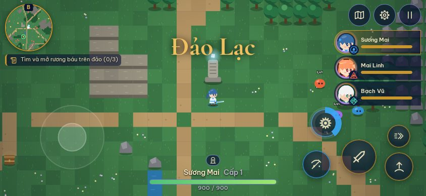
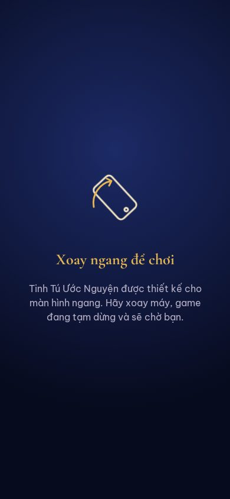
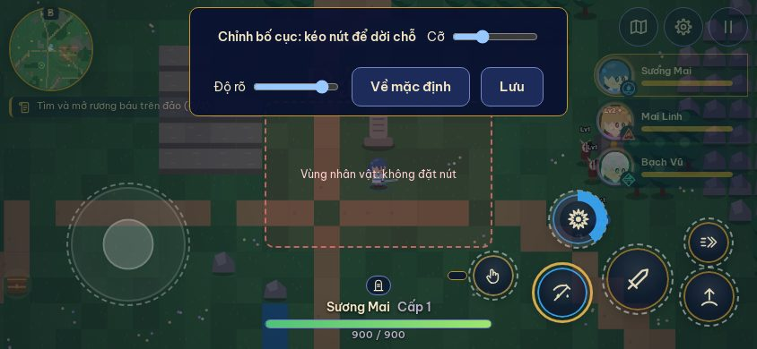
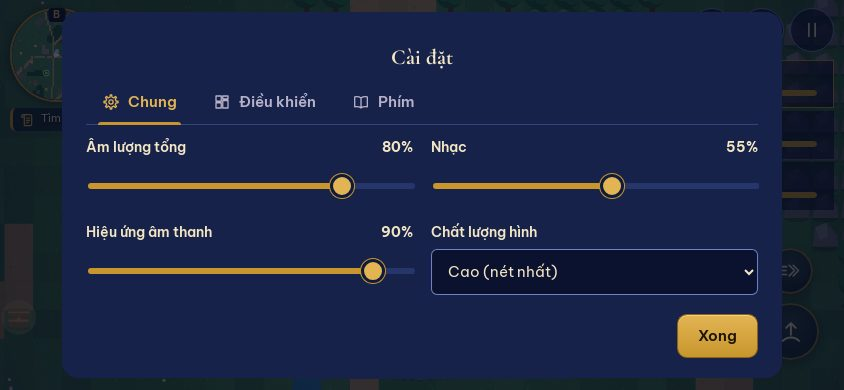
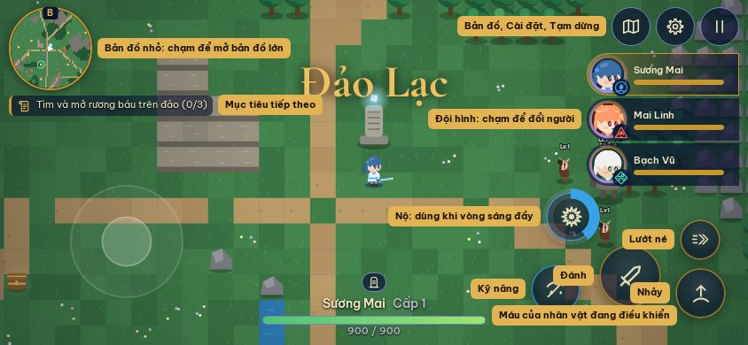

# HUD và điều khiển (S09)

HUD khi chơi, điều khiển cảm ứng, bàn phím, chuột và tay cầm, nhảy, màn xoay ngang và hộp Cài đặt. Phần nhìn dùng tokens, thành phần và biểu tượng của S08 (`docs/ux/he-thong-thiet-ke.md`). Vị trí các khu vực theo bố cục quen thuộc của thể loại (A.3), không chép biểu tượng, khung, màu hay hiệu ứng của game nào.

## 1. Bố cục

| Vị trí          | Thành phần                                                                                                                                                             | Mã                     |
| --------------- | ---------------------------------------------------------------------------------------------------------------------------------------------------------------------- | ---------------------- |
| Trên trái       | Bản đồ nhỏ tròn (chữ B chỉ hướng Bắc, chấm xanh là mục tiêu). Chạm hoặc phím M mở bản đồ lớn có chú giải                                                               | `src/ui/hud/map.ts`    |
| Dưới bản đồ nhỏ | Mục tiêu hiện tại, lấy từ `content/objectives.yaml`; thông tin chế độ (đợt và giây còn lại ở Tháp)                                                                     | `src/ui/hud.ts`        |
| Trái            | Danh sách nhặt đồ trượt (tối đa 5 dòng, gộp vật phẩm trùng), hàng biểu tượng hiệu ứng đang có                                                                          | `src/ui/hud/feed.ts`   |
| Trên phải       | Menu nhanh: Bản đồ, Cài đặt, Tạm dừng (S10 thêm mục khác)                                                                                                              | `index.html`           |
| Phải            | Đội dọc: chân dung, tên, máu, vòng năng lượng nộ (sáng khi đầy), vòng chờ đổi người, số phím (chỉ khi có chuột). Người gục có biểu tượng và chữ "Đã gục" tương phản AA | `src/ui/hud.ts`        |
| Giữa dưới       | Tên, cấp, máu và khiên người đang điều khiển. Máu dưới 30% đổi đỏ, viền màn hình đỏ mờ nhịp đập. Vòng thể lực nhỏ hiện cạnh nhân vật khi đang tiêu, ẩn khi đầy         | `src/ui/hud.ts`        |
| Dưới trái       | Cần điều khiển. Trước khi chạm vẫn hiện vòng mờ ở chỗ mặc định                                                                                                         | `src/core/input.ts`    |
| Dưới phải       | Đánh (to nhất), Kỹ năng bên trái, Nộ phía trên, Nhảy và Lướt sát bên phải nút Đánh. Tương tác hiện bên trái cụm khi đứng gần Bia Đá, rương, cổng                       | `src/ui/hud/layout.ts` |
| Mép màn         | Mũi tên đỏ chỉ về kẻ địch ngoài màn đang ra đòn                                                                                                                        | `src/ui/hud.ts`        |

- Nút Kỹ năng dùng biểu tượng riêng của từng nhân vật (trường `skill.icon` trong `content/characters/*.yaml`, hình trong `src/ui/icons/icons.ts`). Đang hồi chiêu thì vòng tối quay theo `--cd` và chỉ hiện số giây, không chồng chữ.
- Nút Nộ có vòng năng lượng; khi đầy thì sáng theo màu nguyên tố (`is-ready`).
- Thanh máu boss ghi giai đoạn ("Giai đoạn 2: nổi giận").
- Mọi kích thước theo `--tt-hud-*` (theo chiều cao màn hình) và tôn trọng `env(safe-area-inset-*)`.

Ảnh ở các cỡ khác: [932×430](anh/s09-hud-932x430.jpg), [1180×820](anh/s09-hud-1180x820.jpg), [1440×900 máy tính](anh/s09-hud-1440x900.jpg), [bản đồ lớn](anh/s09-ban-do-lon.jpg).

### Vùng giữa

Không nút nào được nằm trong vùng giữa màn quanh nhân vật: hình chữ nhật rộng 30% và cao 42% màn hình (`centerSafe` trong `content/controls.yaml`). Chế độ chỉnh bố cục không cho thả nút vào đó, và test Playwright kiểm tra ở cả ba cỡ màn.

## 2. Điện thoại và máy tính bảng

### Chỉ chơi ngang

- Cầm dọc (cao lớn hơn rộng) trên thiết bị cảm ứng: lớp phủ "Xoay ngang để chơi" có hình máy xoay, game tạm dừng (`GS.paused`), cả ở sảnh. Xoay lại thì chơi tiếp nếu trước đó không tạm dừng. Mã: `src/ui/hud/rotate.ts`.
- Khi bấm vào chơi: gọi `requestFullscreen()` rồi `screen.orientation.lock("landscape")`. Trình duyệt không hỗ trợ (iOS Safari) thì bỏ qua lỗi, lớp phủ vẫn làm việc.
- Máy tính để bàn không bị chặn khi cửa sổ hẹp.

### Cần điều khiển

Cài đặt › Điều khiển:

- **Động** (mặc định): cần hiện ở chỗ đặt ngón trong nửa trái dưới màn. **Cố định**: cần đứng ở chỗ trong bố cục.
- **Vùng chết** 0–50% bán kính (mặc định 15%): kéo ít hơn thì đứng yên.
- **Độ nhạy** 50–200%: cao hơn thì kéo ngắn đã chạy hết tốc.

Công thức ở `joyVector()` trong `src/core/input.ts`: độ dài sau vùng chết được giãn lại về 0–1 rồi nhân độ nhạy, tối đa 1.

### Chế độ chỉnh bố cục

Mở từ Cài đặt › Điều khiển › "Chỉnh bố cục nút". Game tạm dừng, các nút có viền đứt, vùng giữa hiện khung đỏ.

- Kéo nút để dời chỗ. Thả vào vùng giữa, chồng lên nút khác, lên menu nhanh, đội hình hay thanh máu, hoặc ra ngoài vùng an toàn thì nút trả về chỗ cũ và hiện lời nhắc.
- Thanh "Cỡ" (70–160%) và "Độ rõ" (30–100%) đổi nút đang chọn.
- "Lưu" ghi vào `localStorage`, "Về mặc định" trả toàn bộ bố cục theo `content/controls.yaml`.
- Toạ độ lưu theo góc neo (dưới phải hoặc dưới trái) và đơn vị "u" bằng cỡ nút Đánh, nên bố cục giữ đúng tỉ lệ khi đổi máy.

### Rung máy

`src/core/haptics.ts` gọi Vibration API khi trúng đòn và khi rơi mất máu (35 ms, cách nhau ít nhất 120 ms). Tắt trong Cài đặt. iOS không có API này nên không rung.

## 3. Máy tính

- Phím mặc định (`content/controls.yaml`): WASD hoặc mũi tên đi, J đánh, E kỹ năng, Q nộ, Shift lướt, **Space nhảy**, F tương tác, 1–4 đổi người, M bản đồ, Esc tạm dừng. Chuột trái trên màn cũng là đánh.
- Đổi phím: Cài đặt › Phím, bấm ô rồi bấm phím mới. Phím đã gán cho thao tác khác thì **đổi chỗ** hai thao tác, không để trùng. Có nút "Về phím mặc định".
- Gợi ý phím hiện ở góc mỗi nút và cạnh thẻ đội, lấy theo phím đang đặt. Chỉ hiện khi dùng chuột và bàn phím (`html[data-input="mouse"]`). Dùng chuột thì các nút cảm ứng thu nhỏ, cần điều khiển ẩn.
- Rê chuột vào kẻ địch: con trỏ đổi thành hình ngắm riêng (`body.cursor-enemy`).
- Ngắm bằng chuột (tắt mặc định): đòn đánh và kỹ năng hướng về con trỏ thay vì hướng nhân vật đang nhìn.

## 4. Tay cầm

`src/core/gamepad.ts`, đọc Gamepad API mỗi khung hình. Số nút theo bố cục chuẩn.

| Thao tác          | Xbox                      | PlayStation | Nút chuẩn   |
| ----------------- | ------------------------- | ----------- | ----------- |
| Đi                | Cần trái                  | Cần trái    | trục 0, 1   |
| Nhảy              | A                         | ✕           | 0           |
| Lướt              | B                         | ○           | 1           |
| Đánh              | X                         | □           | 2           |
| Tương tác         | Y                         | △           | 3           |
| Kỹ năng           | RB                        | R1          | 5           |
| Nộ                | RT                        | R2          | 7           |
| Bản đồ            | View                      | Create      | 8           |
| Tạm dừng          | Menu                      | Options     | 9           |
| Đổi người 1/2/3/4 | D-pad lên/phải/xuống/trái | như Xbox    | 12/15/13/14 |

- Nhãn tự đổi theo hãng (nhận từ `gamepad.id`), có thể chọn tay trong Cài đặt › Phím.
- Khi đang mở menu, hộp thoại hay sảnh: D-pad hoặc cần trái di chuyển focus theo không gian (`spatialPick`), A chọn, B quay lại (bấm nút có `data-back` hoặc đóng hộp).

## 5. Nhảy

Thông số ở mục `jump` của `content/combat-feel.yaml` (chủ dự án đã duyệt). Mã: `src/combat/jump.ts`, vẽ ở `src/core/render-z.ts`.

| Thao tác            | Thông số                                                                                         |
| ------------------- | ------------------------------------------------------------------------------------------------ |
| Nhảy                | 0,55 giây, đỉnh 1,25 bậc, không tốn thể lực, không nhảy hai lần. Trên không chỉnh hướng được 35% |
| Đang lướt thì nhảy  | Nhảy xa, quãng bay gấp 1,8 lần                                                                   |
| Đang nhảy thì lướt  | Lướt trên không, một lần mỗi lần nhảy, tốn 20 thể lực, vẫn bất tử như lướt thường                |
| Trên không thì đánh | Lao xuống, gây sát thương vùng khi chạm đất: 120% + 40% mỗi bậc độ cao                           |
| Rơi                 | Có hoạt ảnh tiếp đất. Rơi từ 2 bậc trở lên mất 8% máu tối đa mỗi bậc vượt, không làm gục         |
| Né bằng nhảy        | Sóng xung kích sát đất (Golem đập đất, Hắc Giao lao tới) không trúng khi chân cao hơn 0,35 bậc   |

- Bóng đổ dưới chân co lại khi lên cao, nhân vật vẽ nhô lên theo độ cao.
- Nhảy qua được: đá nhỏ, khe nước hẹp, lên bệ đá cao một bậc. Không qua được: cây, bệ hai bậc từ mặt đất.
- Quanh điểm xuất phát Đảo Lạc có bốn bệ đá (một bệ hai bậc) và một khe nước để luyện nhảy.
- Định dạng dữ liệu độ cao, gờ và địa hình cho S12: `docs/world/dinh-dang-ban-do.md`.

## 6. Cài đặt

Mở từ menu nhanh (biểu tượng bánh răng) hoặc hộp Tạm dừng. Đây là hộp thoại phủ lên game, không phải màn hình menu mới. Mã: `src/ui/settings.ts`, lưu trữ: `src/core/settings.ts`.

| Thẻ        | Mục                                                                                                                                                                                           |
| ---------- | --------------------------------------------------------------------------------------------------------------------------------------------------------------------------------------------- |
| Chung      | Âm lượng tổng, nhạc, hiệu ứng; chất lượng hình (cao, vừa, thấp: giới hạn độ nét canvas); rung màn hình; rung máy; cỡ chữ (90–130%); chế độ màu cho người mù màu (đỏ, lục, lam); gợi ý lần đầu |
| Điều khiển | Kiểu cần, vùng chết, độ nhạy, ngắm bằng chuột, chỉnh bố cục nút                                                                                                                               |
| Phím       | Đổi phím từng thao tác, về phím mặc định, kiểu nhãn tay cầm                                                                                                                                   |

- Lưu ở `localStorage["tinhtu-settings-v1"]`, tách khỏi hồ sơ người chơi. Giá trị mặc định ở `content/controls.yaml`.
- Dữ liệu đọc lên được làm sạch (`sanitize`): trường sai kiểu hoặc ngoài khoảng thì lấy mặc định của riêng trường đó, phím trùng thì bỏ.
- Chế độ màu dùng bộ lọc SVG `feColorMatrix` áp lên canvas và HUD, giúp người mù màu phân biệt màu nguyên tố. Mọi trạng thái quan trọng (gục, nộ đầy, máu thấp) có thêm biểu tượng hoặc chữ, không chỉ dựa vào màu.

## 7. Người mới có hiểu HUD không

Tiêu chí: người chơi mới hiểu ý nghĩa mọi thành phần HUD mà không cần đọc hướng dẫn. Cách Devin kiểm tra:

1. **Gợi ý lần đầu.** Lần đầu vào chơi, mỗi khu vực có một nhãn ngắn trỏ vào (ảnh dưới), mờ dần sau khoảng 6 giây. Bật lại trong Cài đặt › Chung. Mã: `src/ui/hud/hints.ts`.
2. **Tên cho trình đọc màn hình và tooltip.** Test Playwright `tests/e2e/hud.spec.ts` kiểm tra mọi nút HUD có `aria-label` tiếng Việt (ví dụ "Kỹ năng: <tên kỹ năng của nhân vật>", "Nhảy", "Mai Linh. Phím 2"). Có chuột thì rê vào nút hiện tooltip cùng tên và phím.
3. **Đọc ảnh như người chưa biết game.** Devin xem lại các ảnh chụp ở mục 1 với câu hỏi "mỗi hình này là gì, bấm vào thì làm gì" mà không dùng kiến thức về mã. Kết quả:

| Thành phần                     | Đoán được không cần gợi ý? | Ghi chú                                                                                        |
| ------------------------------ | -------------------------- | ---------------------------------------------------------------------------------------------- |
| Bản đồ nhỏ, chữ B              | Có                         | Chạm để mở bản đồ lớn thì không tự đoán được; gợi ý lần đầu nói rõ                             |
| Mục tiêu                       | Có                         | Có biểu tượng sổ nhiệm vụ và tiến độ (0/3)                                                     |
| Menu nhanh                     | Có                         | Biểu tượng bản đồ, bánh răng, tạm dừng là quy ước chung                                        |
| Đội hình                       | Có                         | Chân dung, tên, thanh máu. Vòng năng lượng nộ quanh chân dung cần gợi ý lần đầu                |
| Máu nhân vật                   | Có                         | Có tên, cấp và số 900/900                                                                      |
| Cần điều khiển                 | Có                         | Vòng mờ hiện sẵn trước khi chạm                                                                |
| Đánh, Lướt, Nhảy               | Phần lớn                   | Hình kiếm và mũi tên bật lên dễ hiểu; Lướt (các vạch lao tới) cần nhãn gợi ý lần đầu           |
| Kỹ năng, Nộ                    | Cần gợi ý                  | Biểu tượng riêng từng nhân vật nên không đoán được tên; vòng năng lượng giúp hiểu Nộ "cần nạp" |
| Vòng thể lực, mũi tên đỏ ở mép | Cần gợi ý                  | Chỉ hiện khi đang dùng; mũi tên đỏ kèm hướng nên đoán được "có địch ở đó"                      |

Hạn chế: đây là Devin tự đánh giá, không phải người chơi thật. Đề xuất cho 3–5 người chưa chơi thử 5 phút rồi hỏi tên từng thành phần trước khi phát hành.

## 8. Đối chiếu vấn đề của S07 (`docs/ux/danh-gia-hien-trang.md`)

| #            | Trạng thái | Cách sửa                                                                                                                                   |
| ------------ | ---------- | ------------------------------------------------------------------------------------------------------------------------------------------ |
| 1, 2         | Đã sửa     | Lớp phủ xoay ngang, tạm dừng cả ở sảnh                                                                                                     |
| 3            | Đã sửa     | `requestFullscreen` và khóa hướng ngang khi vào chơi                                                                                       |
| 4, 8, 30, 31 | Đã sửa     | Gợi ý phím chỉ hiện khi dùng chuột; dùng chuột thì ẩn cần, thu nhỏ nút cảm ứng                                                             |
| 5, 6, 7, 10  | Đã sửa     | Bố cục mới theo cỡ `--tt-hud-*`, khoảng cách ≥ `--tt-hud-gap`, Lướt và Nhảy sát nút Đánh, đội hình gọn hơn; test kiểm tra không chồng nhau |
| 9            | Đã sửa     | Hồi chiêu chỉ hiện số giây trên biểu tượng tối đi                                                                                          |
| 11           | Đã sửa     | Nút menu nhanh 44×44 trở lên                                                                                                               |
| 12           | Một phần   | Menu nhanh có Bản đồ, Cài đặt, Tạm dừng; S10 thêm Ước nguyện, Đội hình, Ủy thác                                                            |
| 13, 14       | Đã sửa     | Bản đồ nhỏ nhỏ hơn ở điện thoại, chạm mở bản đồ lớn có chú giải                                                                            |
| 15           | Đã sửa     | Vòng cần mờ hiện sẵn                                                                                                                       |
| 16           | Đã sửa     | Dòng mục tiêu và điểm mục tiêu trên bản đồ nhỏ                                                                                             |
| 17, 18       | Đã sửa     | Máu thấp đổi đỏ và viền màn; thẻ người gục có biểu tượng và chữ                                                                            |
| 19           | Đã sửa     | Vòng thể lực cạnh nhân vật, có tên cho trình đọc màn hình                                                                                  |
| 20           | Đã sửa     | Nút Tương tác nằm trong tầm ngón cái phải                                                                                                  |
| 21           | Đã sửa     | Danh sách nhặt đồ trượt                                                                                                                    |
| 23, 24       | Đã sửa     | Vòng chờ đổi người và vòng năng lượng nộ trên từng thẻ đội                                                                                 |
| 26           | Đã sửa     | Thông báo ngắn cho biết hồi sinh ở Bia Đá, không mất vật phẩm                                                                              |
| 28           | Một phần   | Số đợt và giây còn lại hiện ngay dưới mục tiêu, chữ đậm hơn                                                                                |
| 29           | Đã sửa     | Thanh máu boss ghi giai đoạn                                                                                                               |
| 22, 25, 27   | Chưa làm   | Số sát thương trên canvas (S15 đang sửa vẽ), dải cảnh cắt nộ, bản đồ nhỏ trong Tháp và hang Boss: xem Đề xuất trong báo cáo PR             |

## 9. Test

- `tests/unit/controls.test.ts`: cài đặt mặc định, lưu và đọc lại, làm sạch dữ liệu hỏng, đổi phím trùng thì đổi chỗ, vùng chết và độ nhạy, bảng nút tay cầm, nhận hãng, điều hướng focus, kiểm tra bố cục (vùng giữa, chồng nhau, ≥44 px).
- `tests/unit/jump.test.ts`: thông số nhảy, nhảy xa, lướt trên không, lao xuống, sát thương rơi không làm gục, né sóng xung kích, dữ liệu độ cao và gờ.
- `tests/e2e/hud.spec.ts`: chế độ chỉnh bố cục (kéo, đổi cỡ, độ rõ, thả vào giữa bị trả về, tải lại vẫn giữ, về mặc định); cầm dọc thì lớp phủ và tạm dừng; ở 844×390, 932×430, 1180×820 không nút nào chồng nhau hay vào vùng giữa, mọi vùng chạm ≥44 px, có tên; Space nhảy, bản đồ lớn, cài đặt từ hộp Tạm dừng và đổi phím.
