# Menu lớp phủ và trang Admin (S10)

Người chơi luôn ở trong Đảo Lạc. Không còn sảnh: vào game là vào thẳng thế giới, mọi màn menu là **lớp phủ** mở trên thế giới đang tạm dừng. Đóng menu thì chơi tiếp đúng chỗ cũ (vị trí, quái, máu, hồi chiêu giữ nguyên). Phần nhìn dùng tokens, thành phần và biểu tượng của S08 (`docs/ux/he-thong-thiet-ke.md`); HUD và điều khiển giữ nguyên S09 (`docs/ux/hud-dieu-khien.md`), chỉ thêm nút vào menu nhanh.

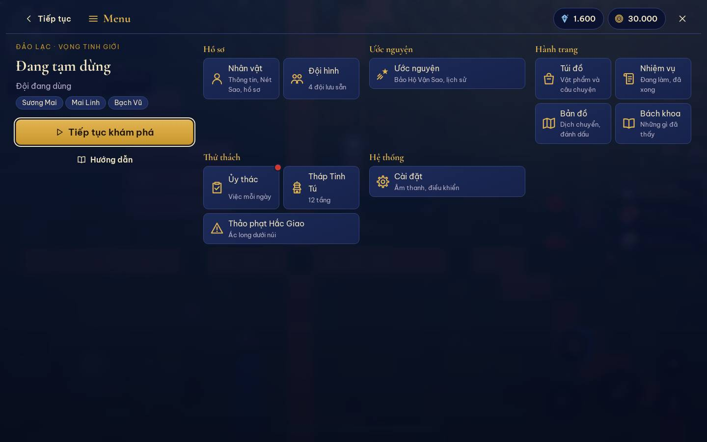

## 1. Khung menu

| Phần        | Mô tả                                                                                                                                               | Mã                         |
| ----------- | --------------------------------------------------------------------------------------------------------------------------------------------------- | -------------------------- |
| Khung       | Lớp phủ `#ttMenu`, thanh trên (Quay lại, tên màn, Đá Sao, Xu, nút đóng), ngăn xếp màn, quản lý focus, trạng thái đang tải và hộp lỗi có nút Thử lại | `src/ui/menu/shell.ts`     |
| Đăng ký màn | `registerScreen(id, { title, icon, render, onKey, onClose })`; mở bằng `openMenu(id)`, `replaceScreen`, `back`, `closeMenu`                         | `src/ui/menu/screens/*.ts` |
| Dữ liệu     | Mục menu chính, nút menu nhanh, thời gian chuyển màn, bán kính chặn đổi đội, mức thân thiết, NPC trên bản đồ                                        | `content/menu.yaml`        |
| Logic thuần | Gợi ý phản ứng, chặn khi đang đánh, lọc và sắp xếp túi đồ, mức thân thiết (có unit test)                                                            | `src/ui/menu/logic.ts`     |

- **Tạm dừng:** khi menu mở, `GS.paused = true` và `GS.overlay = "menu"`; phím và cần điều khiển đang giữ được nhả hết để nhân vật không chạy tiếp khi đóng.
- **Chuyển màn:** mờ và trượt nhẹ trong `transitionMs` (180 ms, dưới 250 ms). Màn cần nạp dữ liệu (Hồ sơ đọc Markdown) hiện vòng tải; lỗi thì hiện hộp báo lỗi và nút Thử lại thay vì màn trắng.
- **Menu nhanh góc trên phải** (S09 giữ Bản đồ và Cài đặt): thêm Ước nguyện, Đội hình, Ủy thác (chấm đỏ khi còn việc hoặc chưa nhận thưởng) và Menu chính.

### Điều khiển

| Việc                    | Bàn phím                                      | Tay cầm         | Cảm ứng                        |
| ----------------------- | --------------------------------------------- | --------------- | ------------------------------ |
| Mở menu chính           | Esc                                           | Start           | Nút Menu ở menu nhanh          |
| Quay lại / đóng         | Esc, Backspace                                | B               | Nút Quay lại, nút ✕            |
| Di chuyển focus         | Tab, mũi tên                                  | D-pad, cần trái | Chạm                           |
| Chọn                    | Enter, Space                                  | A               | Chạm                           |
| Đổi tab                 | Q / E                                         | LB / RB         | Chạm tab                       |
| Đổi nhân vật (Nhân vật) | ← / →                                         | D-pad trái/phải | Vuốt ngang trên chân dung      |
| Chọn ô đội (Đội hình)   | 1–4                                           | D-pad + A       | Kéo thả hoặc chạm              |
| Bản đồ lớn              | Mũi tên kéo, + / − thu phóng, Enter chọn điểm | D-pad, A chọn   | Kéo, chụm hai ngón, cuộn chuột |

## 2. Các màn

| Màn          | Nội dung                                                                                                                                                                                                                                            | Dữ liệu                                                  |
| ------------ | --------------------------------------------------------------------------------------------------------------------------------------------------------------------------------------------------------------------------------------------------- | -------------------------------------------------------- |
| Menu chính   | Đội đang dùng, Tiếp tục khám phá, Hướng dẫn; các nhóm Hồ sơ, Ước nguyện, Hành trang, Thử thách, Hệ thống                                                                                                                                            | `content/menu.yaml`                                      |
| Nhân vật     | Danh sách tự đọc từ `content/characters/` (nhân vật mới tự hiện, chưa có thì khóa). 5 tab: Thông tin, Chỉ số, Kỹ năng, Nét Sao, Hồ sơ. Lời thoại bấm để nghe chữ chạy; mục hồ sơ mở dần theo độ thân thiết                                          | `content/characters/*.yaml`, `docs/characters/<id>/*.md` |
| Đội hình     | 4 đội lưu sẵn, 4 ô mỗi đội; kéo nhân vật vào ô, kéo ô để đổi chỗ; gợi ý "Đội này tạo được Bốc Hơi, Khuếch Tán". Có quái đang đuổi, đang ra đòn hoặc vừa trúng đòn trong 360 px (hoặc boss đang đánh) thì báo "Không thể đổi đội khi đang chiến đấu" | `profile.teams`, `menu.yaml: combatLock`                 |
| Ước nguyện   | Banner nhân vật nổi bật, tab Tỉ lệ, tab Lịch sử lọc theo độ hiếm, Bảo Hộ Vận Sao 5★/4★ và đảm bảo 50/50; nút Ước 1 lần và 10 lần                                                                                                                    | `content/config.yaml: gacha`                             |
| Túi đồ       | Lưới theo loại, sắp xếp theo độ hiếm, tên, số lượng; chi tiết có câu chuyện vật phẩm                                                                                                                                                                | `content/items.yaml` (từ `docs/world/08`)                |
| Nhiệm vụ     | Đang làm, Đã xong, theo dõi một nhiệm vụ, Chỉ đường (đánh dấu trên bản đồ nhỏ và bản đồ lớn)                                                                                                                                                        | `content/quests.yaml`, `objectives.yaml`                 |
| Bản đồ lớn   | Thu phóng 1–4×, kéo, sương bản đồ theo ô đã đi qua, biểu tượng Bia Đá, rương đã thấy, cổng Tháp, hang Hắc Giao, NPC quan trọng, nhiệm vụ; dịch chuyển tới Bia Đá đã mở (bị chặn khi đang đánh); tối đa 30 điểm đánh dấu tự do                       | `profile.fog`, `profile.marks`, `menu.yaml: npcs`        |
| Bách khoa    | Sinh vật, Nhân vật, Địa danh, Vật phẩm, Thế giới. Chưa khám phá thì hiện bóng đen và "???". Mở khi hạ quái, có nhân vật, đi tới gần, nhặt đồ                                                                                                        | `content/codex.yaml` (từ `docs/world/`)                  |
| Ủy thác      | Việc trong ngày, tiến độ, nhận thưởng từng việc và thưởng ngày                                                                                                                                                                                      | `content/config.yaml: daily`                             |
| Tháp Tinh Tú | 12 tầng, sao đạt được, tầng khóa                                                                                                                                                                                                                    | `content/config.yaml`                                    |
| Hắc Giao     | 5 cấp độ, máu, thưởng lần đầu                                                                                                                                                                                                                       | `content/enemies/`                                       |
| Cài đặt      | Giữ logic S09, chỉ mở từ menu                                                                                                                                                                                                                       | `src/ui/settings.ts`                                     |

**Độ thân thiết (tạm):** mỗi nhân vật được 0,05 điểm mỗi giây ra trận và 1 điểm mỗi quái hạ khi đang điều khiển, chia 10 mức (`menu.yaml: affinity`). Mức mở từng mục hồ sơ ghi ở `menu.yaml: profile`.

### Hoạt ảnh ước nguyện

`src/ui/wish/cinematic.ts` chuyển từ bản mẫu `uoc-nguyen-mau.html` của chủ dự án, giữ nhịp và ý tưởng 5 cảnh có khung điện ảnh:

1. Vách đá thả đèn trời.
2. Lên trời vẽ chòm sao.
3. Sao băng xuyên không gian (5★ giả làm 4★ rồi quay chậm và bùng vàng).
4. Sao băng rơi xuống trống đồng.
5. Giới thiệu nhân vật bằng bóng đen viền sáng rồi tràn màu; cuối cùng là bảng tổng kết lật thẻ.

Kết quả lấy từ `Server.req("pull")`, không tự quay trong hoạt ảnh. Nút Bỏ qua chuyển thẳng tới bảng tổng kết. Nhịp các cảnh ở `content/cinematic.yaml`.

`src/ui/wish/player.ts` (`WishPlayer`) là chỗ cắm video của S20: khi `content/cinematic.yaml: videos` có đường dẫn theo độ hiếm cao nhất thì phát video, không có file, lỗi hoặc tải quá `videoTimeoutMs` thì dùng bản code. Hiện danh sách video để trống.

## 3. Trang Admin `/admin/`

Trang riêng (Vite nhiều trang: `admin/index.html`, `src/admin/`), có bố cục và điều hướng riêng, dùng được trên máy tính và máy tính bảng. **Trong game không có nút hay đường dẫn nào tới trang này**; mở bằng tay `http://localhost:5173/admin/` (hoặc `<địa chỉ bản chơi thử>/admin/`).

Các mục: Tổng quan, Ước nguyện (cấu hình và lịch sử), Cấp tài nguyên và nhân vật, Chế độ GM (bất tử, một đòn hạ gục, không hồi chiêu), Ủy thác, Kinh tế (khung sẵn cho S19), Điểm bỏ cuộc (khung sẵn cho S13), Nhật ký request.

Dữ liệu dùng chung với game qua `Server` giả lập trên `localStorage` (`tinhtu-v3`, nhật ký request ở `tinhtu-log`). Mở game và Admin ở hai tab cùng địa chỉ: cấp Đá Sao ở Admin thì game cập nhật ngay qua sự kiện `storage`.

### Mật khẩu

> **Chỉ là chặn tạm ở bản thử nghiệm.** Mọi thứ chạy trên trình duyệt, ai đọc mã nguồn cũng vượt được. Khi có server thật, việc xác thực phải chuyển lên server.

- Mật khẩu mặc định: `tinhtu-admin`. Repo chỉ giữ salt và hash PBKDF2-SHA256 (120 000 vòng) trong `content/admin.yaml`, không giữ mật khẩu gốc.
- Đổi mật khẩu:

  ```bash
  pnpm admin:hash "mật-khẩu-mới"
  ```

  Lệnh in ra `salt` và `hash` mới (salt ngẫu nhiên). Dán đè hai dòng đó vào mục `login` của `content/admin.yaml`, rồi build lại.

- Phiên đăng nhập lưu trong `sessionStorage`, hết hạn sau `sessionMinutes` (120 phút) hoặc khi đóng tab; nút Đăng xuất xóa phiên.

## 4. Server giả lập

Hồ sơ nâng lên `v: 3` (khóa `tinhtu-v3`), tự chuyển từ `tinhtu-v2` không mất dữ liệu. Phần mới: `teams` và `team` (4 đội), `bag`, `quests`, `fog`, `marks`, `codex`, `affinity`, `econ`, `quits`. Route mới: `setTeam`, `useTeam`, `addItems`, `trackQuest`, `completeQuest`, `explore`, `addMark`, `delMark`, `discover`, `affinity`, `logQuit`. Giao diện chỉ đổi hồ sơ qua `Server.req`, để sau thay bằng API thật.

## 5. Ảnh chụp

Mọi màn ở 3 cỡ nằm trong [`anh/s10/`](anh/s10/), tên `<cỡ>-<màn>.jpg` với cỡ `may-tinh` (1440×900), `dien-thoai` (844×390), `may-tinh-bang` (1180×820). Trang Admin chụp ở máy tính và máy tính bảng.

| Máy tính 1440×900                     | Điện thoại 844×390                        | Máy tính bảng 1180×820                         |
| ------------------------------------- | ----------------------------------------- | ---------------------------------------------- |
| 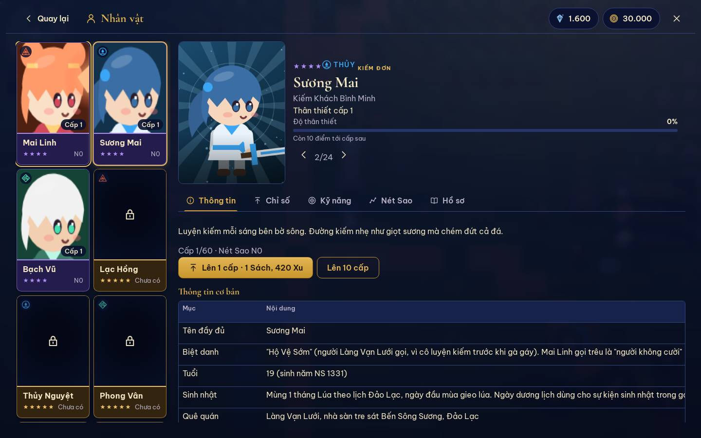       | 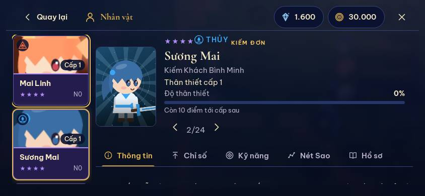         | 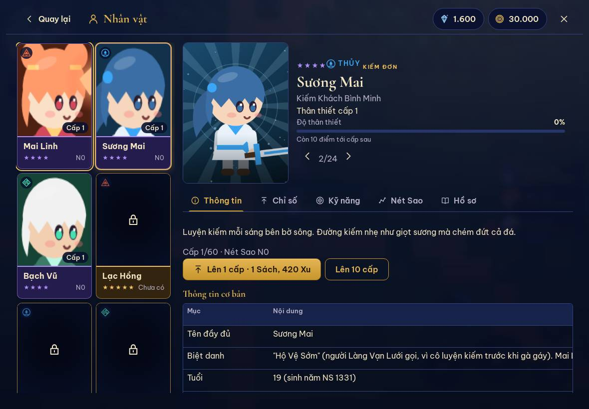           |
| 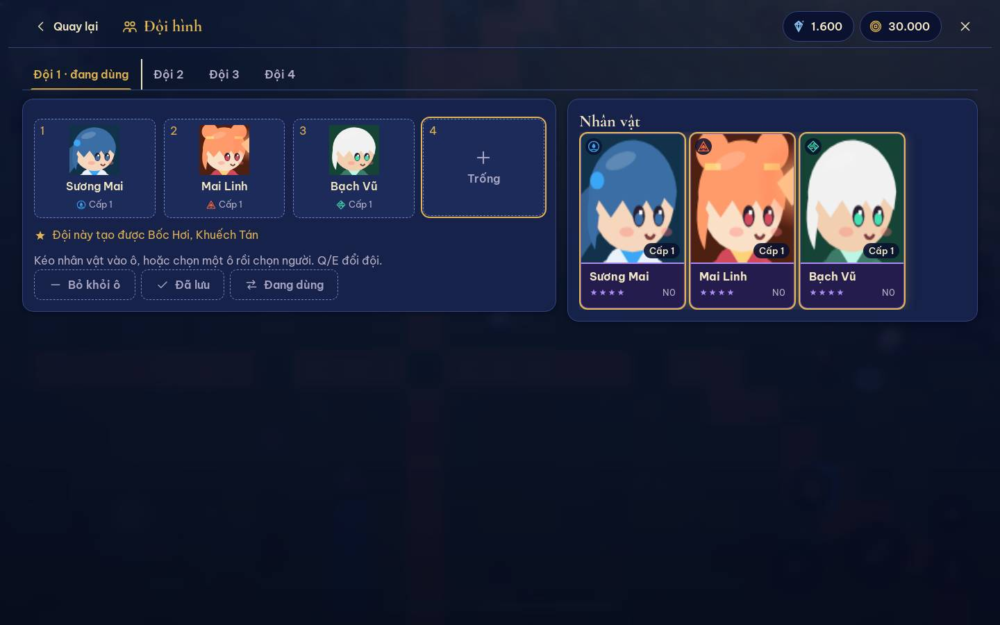        | 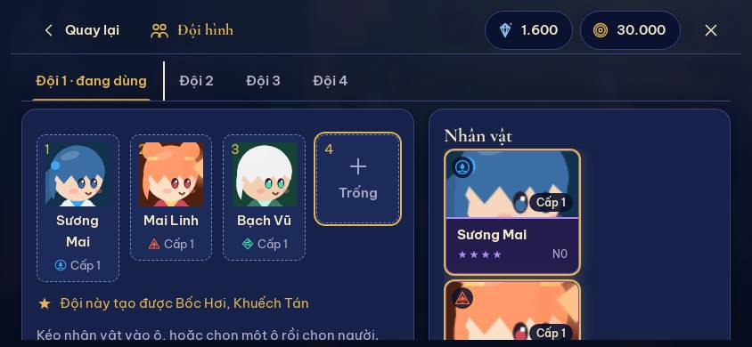          | 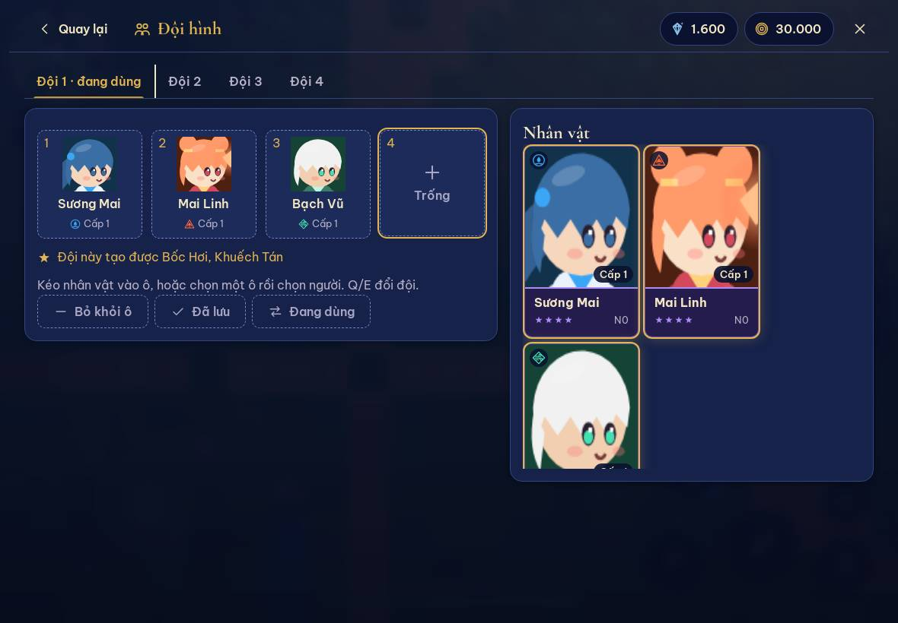            |
| 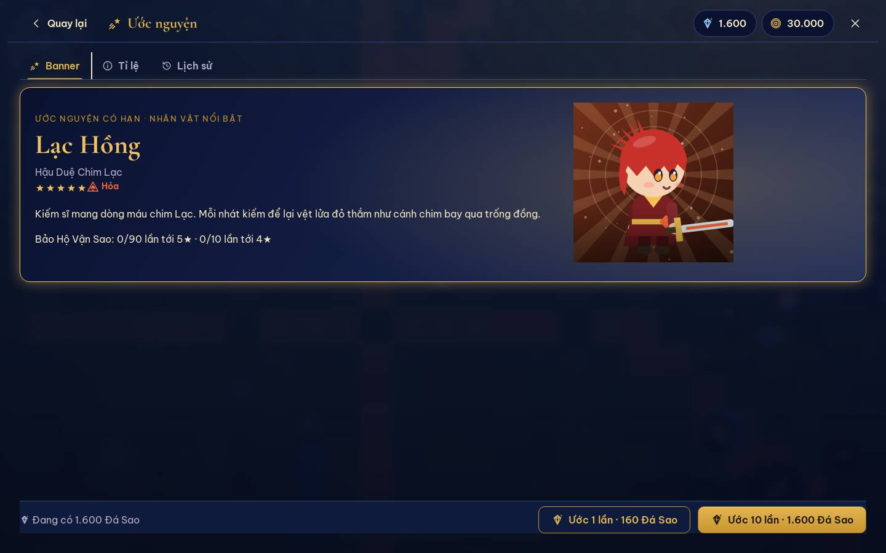        | 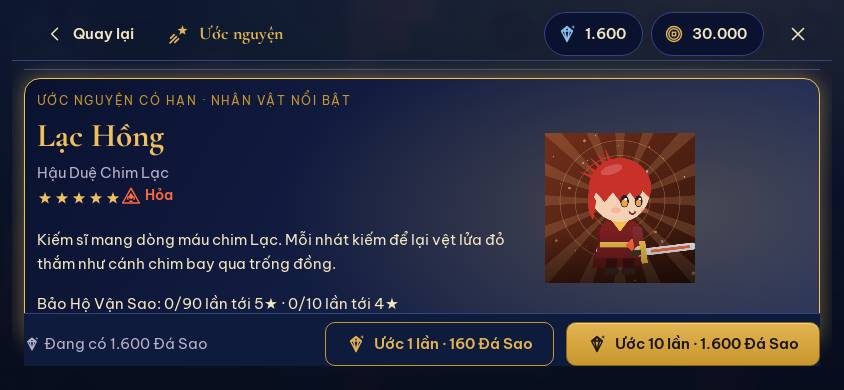          | 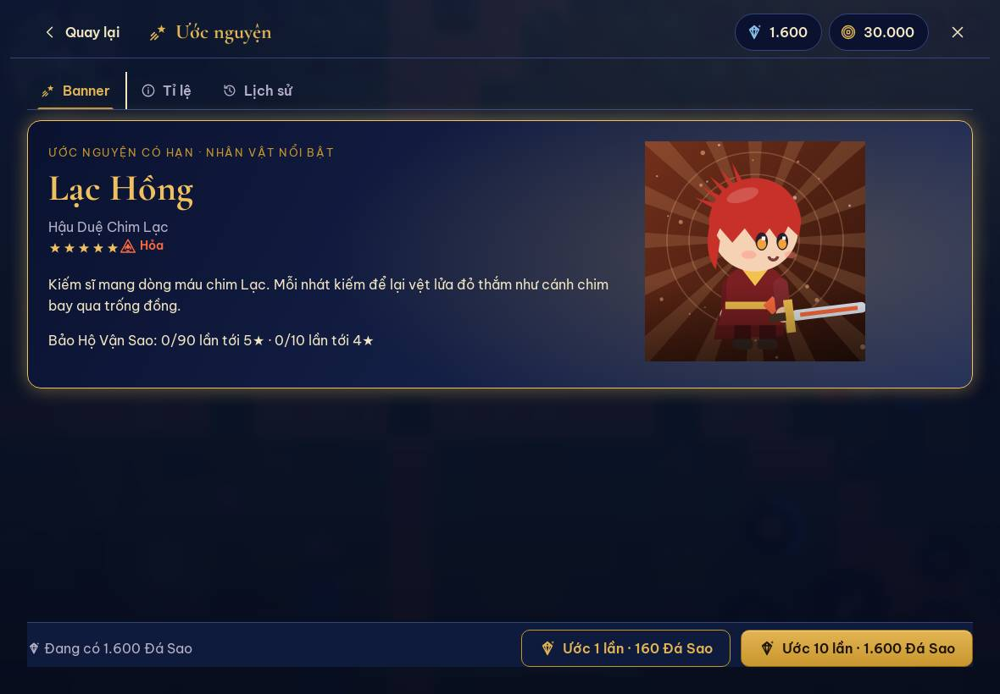            |
| 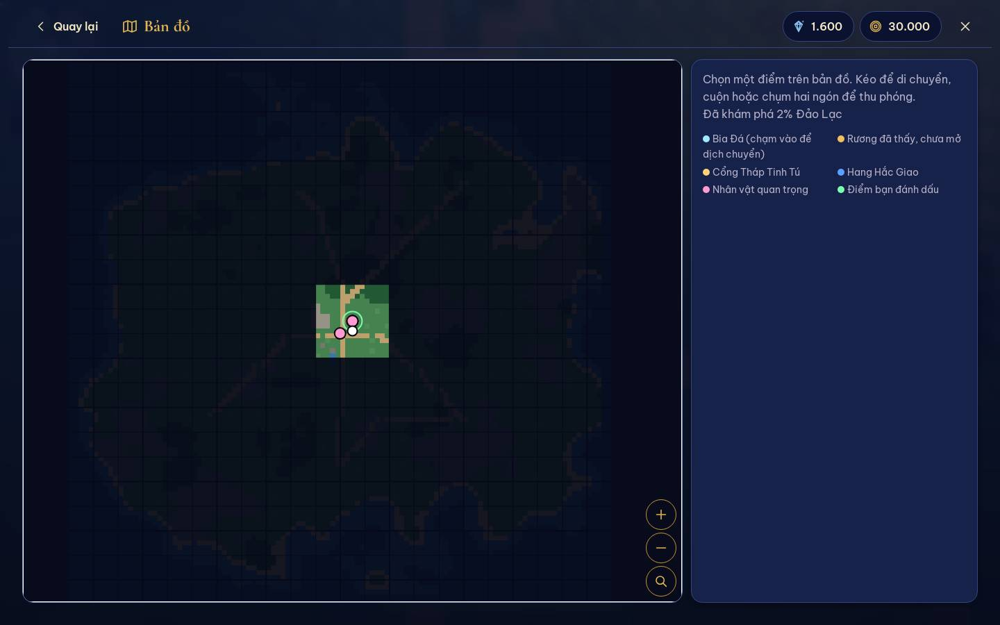         | 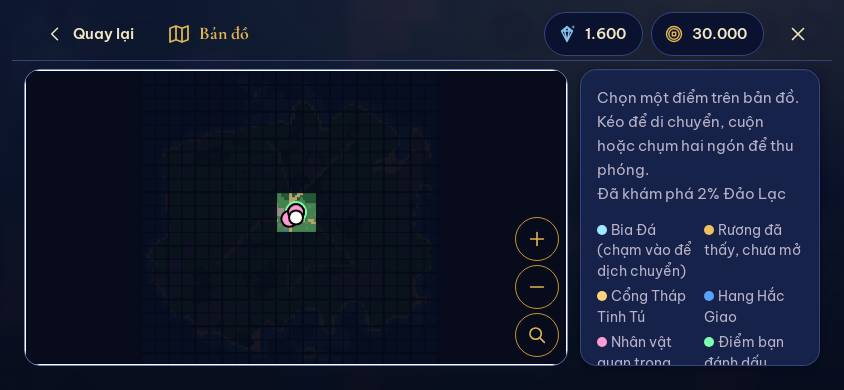           | 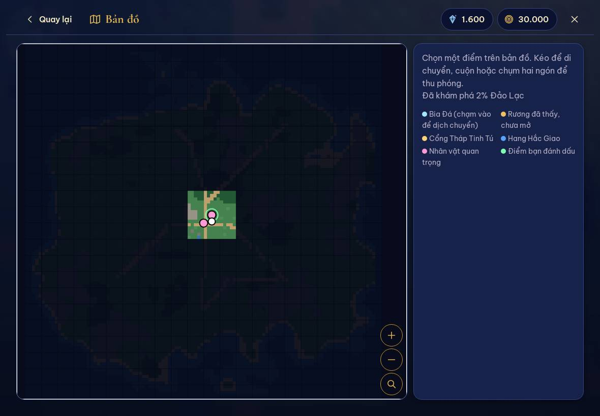             |
| 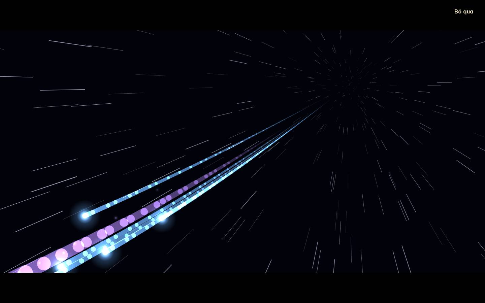 | 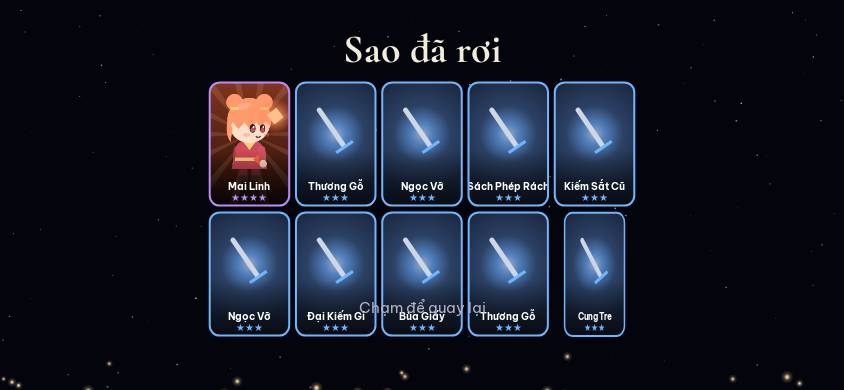 | 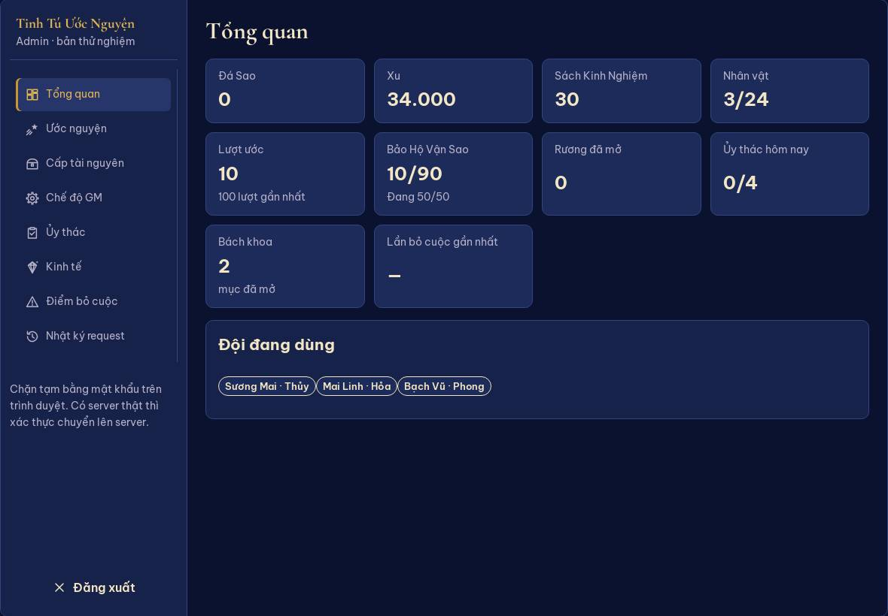 |

## 6. Kiểm thử

- Unit: `tests/unit/menu.test.ts` (chuyển hồ sơ v2→v3, gợi ý phản ứng, chặn đổi đội, lọc và sắp xếp, túi đồ, nhiệm vụ, bản đồ), `tests/unit/admin.test.ts` (đăng nhập, phiên hết hạn).
- Đầu cuối: `tests/e2e/flow.spec.ts` (vào đảo → menu → đổi đội và bị chặn khi đánh; ước 1 và 10 lần, bỏ qua; nhân vật đổi tab, phím mũi tên, vuốt; bản đồ dịch chuyển; Tháp, Boss; Admin đăng nhập và cấp Đá Sao; chuyển màn dưới 250 ms; không lỗi console).
